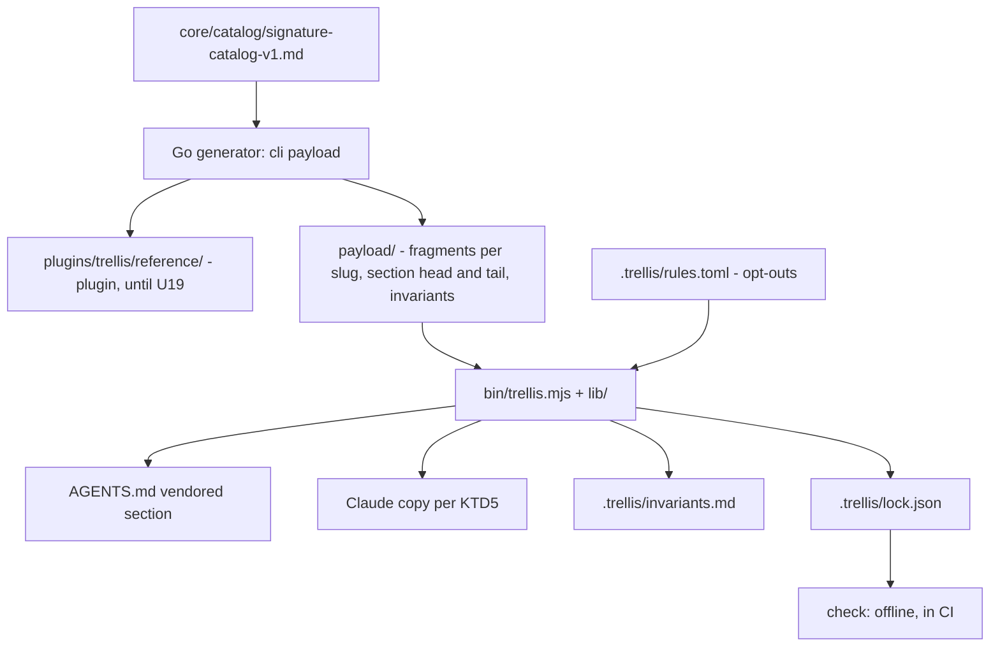
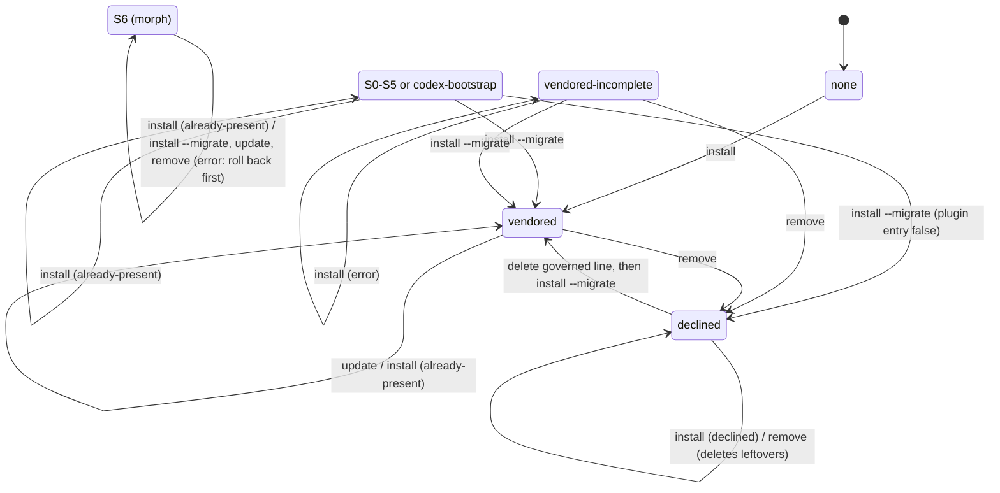
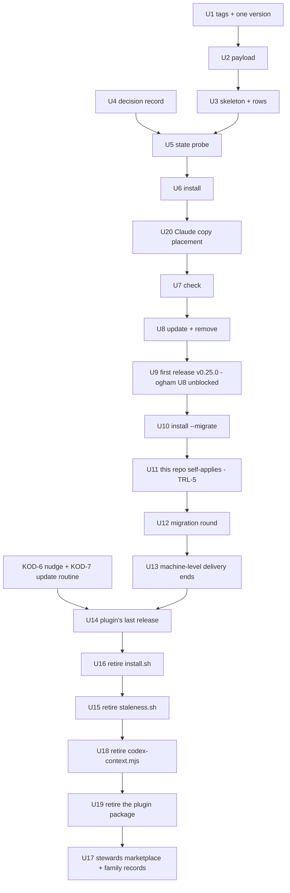

# Trellis delivers its rules as committed files - Plan

## Goal Capsule

- **Objective:** Every session in a repo that adopted Trellis starts with the same rules, wherever it runs: the maintainer's laptop, claude.ai/code cloud, Codex or Droid. A repo adopts, updates and leaves Trellis through one explicit command whose result is a diff someone reviews.
- **Means:** A Trellis CLI, run as `npx github:kodhama/trellis#v<version> install|update|check|remove`, writes the rules into files the repo commits. The Claude plugin, both session-start hooks, `install.sh` and decision-0073's closed set of seven delivery states retire after one migration round.
- **Product authority:** the maintainer (`gundisalwa`), through the Simplify Trellis project, issue TRL-107. The requirements were confirmed in dialogue on 2026-10-09, and merging this file is the approval. The Kodhama family install convention, the machine and cloud setup for skill-type tools, and ogham's U8 change are not active scope (see How This Work Fits Together). The build plan (Planning Contract onward) is TRL-117; its units become TRL-113's build stories.
- **Authority order:** the Product Contract's requirements win on behaviour; a KTD wins on mechanism within them; a unit overrides neither.
- **Execution profile:** one worker at a time, one unit per PR, each PR small enough to review on a phone. U12 is the exception: one PR per consumer repo, each its own story; U13 has no PR. The maintainer merges every PR.
- **Stop conditions:** a unit stops and asks its lead when a requirement looks wrong against the code, when a KTD cannot hold, or when R16's gate (KOD-6 and KOD-7) is not met.
- **Open blockers:** none. The CLI's language (KTD1), migration as a flag (KTD10) and R14's narrowing to S0–S5 were settled on 2026-10-18.

---

## Product Contract

### Summary

Trellis stops delivering rules through a plugin and a session-start hook. A repo adopts Trellis by running the Trellis CLI once. The CLI writes the rules, minus the repo's opt-outs, into committed files that every host reads at session start. Updating means running the CLI again and reviewing the diff. Existing consumers move over in one round of PRs, and the plugin then retires.

### Problem Frame

Trellis reaches a session today through a plugin whose hook decides at session start what to inject. Four costs follow from that.

**The rules a session sees depend on the machine, not the repo.** On 2026-10-09 the repo's HEAD was plugin 0.24.2, while this machine's installed copies were 0.22.0 or 0.23.1 (TRL-5 triage comment). `installed_plugins.json` holds 113 project-scope Trellis records at 0.22.0 and 31 at 0.11.0.

**Cloud and Codex sessions are second-class.** A claude.ai/code session installs no plugin a repo declares in `enabledPlugins`, so it gets Trellis only when an environment setup script installs it (`plugins/trellis/README.md:62-71`). Codex support is "not supported yet" (`plugins/trellis/README.md:135-142`). A committed `.claude/rules/trellis.md`, by contrast, loaded on turn one in cloud (`plugins/trellis/README.md:71-72`).

**Every component re-derives the delivery state.** decision-0073 found five components each holding "a private, partial enumeration" of the seven states S0–S6 and made itself their single home. ogham's plan unit U8 was about to become a sixth copy: as planned, it probes S0–S6 itself and writes `.trellis/rules.toml` and `.claude/settings.json` entries (kodhama/ogham PR #1, KTD6).

**The machinery outweighs the rules.** `staleness.sh` is 1,526 lines, `codex-context.mjs` is 1,366 lines and `install.sh` is 1,136 lines. About 11.6k test lines pin them, and about 18 decision records own them. The payload they deliver, `reference/rules.md`, is 6,070 bytes.

The trigger in the Ideas entry "Simplify Trellis delivery" fired when ogham's plan was approved (D17, 2026-10-08). It names the comparison directly: ogham chose a vendored kit with no hook so that "a cloud session sees exactly what the laptop sees" (KOD-5).

### Key Decisions

- **Vendored delivery: the repo holds the rules, and updating means re-running the CLI and reviewing the diff.** The same files reach every host. The cost is that a repo stays behind until someone updates it. (session-settled: user-approved — chosen over plugin-only delivery with automatic updates: that keeps the machine lag and the cloud gap.) Governs R2, R5, R8, R11.
- **Trellis keeps no plugin; the CLI is its only delivery path.** Rules must be in context from turn one, and a skill loads only when an agent calls it, so a plugin would add a channel without adding a capability. (session-settled: user-approved — chosen over a hookless plugin whose commands wrap the CLI, and over the full impeccable.style model where a plugin also delivers rules live.) Governs R11, R16.
- **Tools split by payload type.** Rule-type tools (Trellis, ogham) are vendored per repo by their own CLI. Skill-type tools (compound-engineering, grove, impeccable's skill) are installed once per machine at user scope and once in the cloud Default environment, and each repo also declares them in its committed `.claude/settings.json` so the repo is self-sufficient in its tooling. The declaration alone installs nothing in cloud, so it supplements the machine and cloud installs and does not replace them. This plan covers only Trellis's side of that split. (session-settled: user-approved — chosen over a family "stack bootstrap" product that runs every tool's installer: a cloud session never installs repo-declared plugins, and committed ids rot unnoticed, as design-system's `main` still enables `grove@kodhama`, which the kodhama marketplace no longer lists. The per-repo declaration is user-directed, 2026-10-10, relayed by majordomo: "I think the plugin should be declared in the repo, so the repo is self-sufficient in its tooling.")
- **The family install convention lives as a doc in the kodhama repo,** and Trellis conforms to it. (session-settled: user-directed — chosen over a Kodhama Linear doc and over stating it in this plan.)
- **One migration round, with named exemptions.** (session-settled: user-approved — chosen over migrating each repo when it is next touched, which would keep two delivery paths alive for an open-ended time.) Governs R14, R15, R16.
- **`check` guards integrity, not freshness.** Failing CI on every new release would break each adopted repo's main branch on every release; there were 26 VERSION bumps between 2026-07-24 and 2026-10-09. (session-settled: user-approved — confirmed with the scoping synthesis.) Governs R12, R13.
- **`governed = false` remains the one recorded decline.** Without a record, a nudge or another tool's bootstrap cannot tell a declined repo from one never asked. A `"trellis@kodhama": false` plugin entry is not a decline: no shipped code reads it, and it goes when the plugin does. (session-settled: user-directed, 2026-10-10 — chosen over counting both `governed = false` and a `false` plugin entry, as ogham D16 did.) Governs R3, R6, R14.
- **`remove` leaves a decline behind.** A repo that removed Trellis said no, and decision-0077 holds that silence is not adoption. Without the record, the next tool that calls `install` would re-adopt the repo. ogham asked for this ("never re-seeds over a removal"). Governs R6.
- **The CLI is the only code that knows Trellis's delivery states.** Every other caller asks the CLI and does not enumerate states itself, which closes the root cause decision-0073 named. Governs R3, R18.
- **The invocation names the GitHub repo, not an npm package.** The npm name `trellis` belongs to an unrelated publisher (turtle.tech, an "Agentic State Engine"), and `@kodhama/trellis` does not exist; checked 2026-10-09. The `github:` form is the one ogham uses. Governs R1.

### Requirements

**The CLI and adoption**

- R1. One CLI, invoked as `npx github:kodhama/trellis#v<version> <verb>`, provides `install`, `update`, `check` and `remove`. Each verb runs with no prompt and ends with one stdout line and an exit code that state its outcome: for `install`, installed, already present or declined; for migration (R14), migrated; for `check`, pass or fail; for `update` and `remove`, done; for any verb, error.
- R2. In a repo with no Trellis state, `install` writes the rules into committed files and records the installed version in a lock. It also says what it adopted. Running `install` is the adoption act; decision-0070 D2 already holds that "running an installer inside a repository is an unambiguous adoption act".
- R3. `install` changes nothing in a repo that already carries any Trellis state or a recorded decline, and it reports which one it found. On a decline, the line says how a person reverses it: delete `governed = false` from `.trellis/rules.toml`, then run the migration mode (R14), which adopts a repo whose `rules.toml` is all that remains. `install` itself never overrides a decline. The one recorded decline is `governed = false` in `.trellis/rules.toml`.
- R4. `install` does not refuse because other files in the working tree are untracked or uncommitted.
- R5. `update` re-renders the rules from the requested version, keeps the repo's opt-outs, and leaves the change as a diff for review.
- R6. `remove` deletes every file and section Trellis wrote except `.trellis/rules.toml`, which it leaves holding `governed = false`, so no later `install` call re-adopts the repo silently.
- R7. The rendered rules leave out every rule the repo switched off, under the opt-out semantics of `docs/decisions/2026-09-15-rule-rows-only-switch-rules-off.md`. A change to the opt-outs takes effect at the next `update`.

**What a session sees**

- R8. Rules reach Claude Code (laptop and cloud), Codex and Droid from the repo's committed files alone, from the first turn, with nothing installed on the machine or in the cloud environment.
- R9. Each host loads the rules exactly once. A repo whose `CLAUDE.md` imports `AGENTS.md` does not also get a separate Claude copy, and a repo nested inside another adopted repo, such as the repos under `~/hq`, does not inherit a second copy from its parent.
- R10. For Codex and Droid, which cannot import a file from `AGENTS.md`, the rules are inlined in one marked section of `AGENTS.md`. That section sits beside other tools' marked sections and never wraps them. It stays near today's inline block (7,065 bytes) so it fits within Codex's 32 KiB `AGENTS.md` limit alongside ogham's inline core (ogham D20). `install`, `update` and `check` warn when the `AGENTS.md` content Codex reads exceeds 32 KiB, as ogham's KTD2 does.
- R11. On a machine where the round ran (R19), no hook or startup script runs in any session for Trellis.

**Integrity**

- R12. `check` runs offline. It fails when the committed Trellis files differ from what the lock records as written, as a hand edit or a partial write would cause, and when the opt-outs in `.trellis/rules.toml` differ from the opt-outs the lock records as rendered, naming the rows. The existence of a newer release never fails it.
- R13. In this repo, the committed Trellis files match what HEAD's own payload renders, and CI fails when they do not. This closes TRL-5.

**Migration and retirement**

- R14. An explicit migration mode, separate from plain `install`, converts a repo in any of decision-0073's states S0–S5 to the vendored form. On S6 (morph) it changes nothing and exits with an error telling the person to roll back first. It keeps the opt-out rows and removes the old overlay, inline block, rendered file or bundle, as well as every Trellis plugin entry: `trellis@kodhama` in `.claude/settings.json` and `trellis@stewards` in a committed `.factory/settings.json` (Droid). A repo whose entry is `false` keeps its no: migration writes `governed = false` and strips the entry. *The maintainer approved this wording on 2026-10-18, through the lead; it amends the confirmed R14, which named S0–S6.*
- R15. One round of PRs migrates every live consumer in the inventory below. wisp and review-kit are named exemptions: TRL-104's resume brief records that both are being retired, and they keep their current state until they go. Each migration PR also wires `check` into the repo's CI where the repo has CI, running the version the lock records rather than one written into the workflow, so `update` never edits CI files; it also rewrites the `rules.toml` header comment that says rows govern rule activation live.
- R16. After the round, and only once the nudge line (KOD-6) and the update routine (KOD-7) exist (see Dependencies), the plugin ships one last release and then retires. That last release injects nothing in a repo that carries the Trellis lock; anywhere else it delivers the rules as before and also says the plugin is retiring and gives the CLI command. Retiring it removes `staleness.sh`, `codex-context.mjs`, `install.sh` and their tests from this repo, and the `trellis` entry from the kodhama marketplace in kodhama/stewards, which is a stewards change. A decision record written by the build replaces decision-0073's closed set. *The maintainer approved this reading on 2026-10-18, through the lead: "notice, then stop". The last release is the last that delivers rules, with the retiring notice. The releases that remove the hooks afterwards are the retirement, and they end delivery.*
- R17. A consumer outside the inventory that still runs the plugin keeps working until the plugin retires. A migrated repo does not load the rules twice on a machine whose install runs R16's last release; on a machine with an older install, R19's uninstall is what prevents it.
- R19. The round also ends machine-level delivery on each machine the inventory covers: it uninstalls `trellis@kodhama` at user scope from Claude Code and from Codex, uninstalls `trellis@stewards` at user scope from Droid and removes it from untracked project `.factory/settings.json` files, and removes the Trellis lines from cloud environment setup scripts. Until then, a user-scope install keeps injecting rules and advice into migrated repos.

**Callers**

- R18. Trellis's supported way for another tool, such as ogham's `install`, to adopt it is calling `install` pinned to a version tag and reading the outcome from R1's line and exit code. Trellis makes no promise about any other path.
- R20. Every Trellis release creates the tag `v<version>` on its merge commit on `main`, and CI fails a release whose tag is missing. `v*` tags cannot be created, moved or deleted outside that path, so a pin always names reviewed, merged code. The new tags never reuse a name from `v0.1.0`–`v0.2.30`, which already exist for the retired v0 CLI (the repo's tag list; root `README.md:285` describes that CLI); those old tags are not a supported pin.

Consumer inventory for R15, found by scanning `~/hq` and `~/projects` on 2026-10-09:

| Repo | State today | R15 |
|---|---|---|
| design-system | S2 overlay + S4 block in `CLAUDE.md`, plugin declared | migrate |
| spore | S2 overlay + S4 blocks in `CLAUDE.md` and `AGENTS.md`, plugin declared | migrate |
| mq-source | S3 flat overlay + S4 block in `CLAUDE.md`, no `rules.toml` | migrate |
| kodhama, ogham, stewards, trellis (this repo), math-quest, math-quest-bmad, math-quest-openspec, math-quest-narrative, math-quest-supervision | S0: `rules.toml` + plugin declared | migrate |
| `~/hq`, machine-skills | `rules.toml` only | migrate |
| wisp, review-kit | S0, being retired | exempt |

The scan covered one machine. Consumer repos elsewhere, such as a consultant-mode company repo, are not listed and fall under R17.

### Acceptance Examples

- AE1. **Covers R1, R2.** **Given** a repo with no Trellis state, **when** `install` runs, **then** the rules files and the lock are written, the stdout line says installed, and the exit code is success.
- AE2. **Covers R3.** **Given** a repo whose `rules.toml` says `governed = false`, **when** `install` runs, **then** no file changes and the stdout line says declined.
- AE3. **Covers R3, R14.** **Given** spore (S2 overlay plus S4 blocks), **when** plain `install` runs, **then** nothing changes and it reports the states it found. **When** the migration mode runs instead, **then** spore ends in the vendored form, its opt-out rows are unchanged, and the overlay, both blocks and the plugin entry are gone.
- AE4. **Covers R4, R18.** **Given** ogham's `install` has just written untracked `.ogham/` files, **when** it calls `install`, **then** Trellis installs and ogham reads "installed" from the stdout line.
- AE5. **Covers R5, R12.** **Given** a repo installed at v1 when v2 is released, **when** `check` runs, **then** it passes. **When** `update` runs to v2, **then** the change appears as a diff and `check` passes against the new lock.
- AE6. **Covers R12.** **Given** someone hand-edits the rendered rules, **when** `check` runs, **then** it fails and names the file.
- AE7. **Covers R8.** **Given** a migrated repo and a cloud environment with no setup script, **when** a claude.ai/code session starts, **then** the rules are in context on turn one.
- AE8. **Covers R9.** **Given** a repo whose `CLAUDE.md` is exactly `@AGENTS.md`, **when** a Claude session starts, **then** the rules appear once.
- AE9. **Covers R6, R3.** **Given** `remove` has run in a repo, **when** ogham's `install` later calls Trellis's `install`, **then** the stdout line says declined and nothing is re-adopted.
- AE10. **Covers R12.** **Given** someone commits `<slug> = { active = false }` to `rules.toml` without running `update`, **when** `check` runs, **then** it fails and names that row.
- AE11. **Covers R19, R9.** **Given** a migrated repo on a machine where the round ran, **when** a Codex or Droid session starts, **then** no Trellis hook runs and the rules appear once, from `AGENTS.md`.

<!-- ce-section: work-relationships -->
### How This Work Fits Together

This plan covers Trellis's own delivery. The breakdown below is the current understanding, not a committed roadmap.

- **Kodhama family install convention** (a doc in the kodhama repo; majordomo routes it): rule-type tools vendor per repo through their CLI, and skill-type tools install per machine and in the cloud Default environment and are declared in each repo's committed settings. *Shares* the CLI shape with this plan; this plan conforms to it.
  - **Machine and cloud setup for skill-type tools** (compound-engineering, grove, impeccable's skill). *Can proceed independently of* this plan.
  - **The nudge** (KOD-6): one line in the maintainer's global agent instructions that offers adoption in a repo without Trellis or ogham, asked through the question dialog and never acted on headless. *Depends on* R1 and R3. *Enables* R16: it replaces the plugin's in-session adoption offer, so the plugin does not retire before it exists.
  - **An update routine** (KOD-7) that runs `update` across adopted repos and opens one PR per repo. *Depends on* R1 and R5. *Enables* R16.
- **ogham U8** (ogham D19, replacing KTD6's own probe): *depends on* this plan's CLI being tagged.
- **TRL-5** (this repo does not dogfood HEAD): closed by R13.
- **Idea 5, "One delivery path"** (listed in TRL-104's resume brief; `docs/ideation/2026-09-14-repo-simplification-ideation.html`): this plan takes its place. TRL-104's other ideas are untouched. It keeps that idea's migration round and its constraint that adoption stays explicit, and it replaces "plugin-native only" with vendored files.

### Scope Boundaries

- The family convention doc, the skill-tool setup script, the nudge line and the update routine (see How This Work Fits Together). R16 waits on the last two, but building them is not this plan's work.
- ogham's U8 change and the superseding entry ogham records against its D16 and KTD6.
- A decline marker for a client repo that should not commit any Trellis file. Deferred: `governed = false` is committed, and no client repo is in the inventory.

### Dependencies / Assumptions

- **Assumption, measured once:** a committed `.claude/rules/*.md` file loads on turn one in a claude.ai/code session (`plugins/trellis/README.md:71-72`). R8 rests on it.
- **Assumption, not measured:** Codex and Droid follow rules inlined in `AGENTS.md` about as well as Claude follows its rules file.
- **Release drift stays visible only through the update routine.** Once the hook retires, nothing in a session reports that a repo is behind, and `check` never fails on a newer release. The routine's per-repo update PR is where drift becomes visible (floor-transparency), so R16 waits on it. The nudge line is tracked as KOD-6 and the update routine as KOD-7, both in the Kodhama team.
- **A decision record is due with the build, not with this plan.** Retiring the delivery machinery meets the record test, because a wrong call could silently stop rules reaching sessions. Records the build must retire or note: decision-0073 (closed set), 0065 (plugin path), 0071 (project-scope plugin declaration), 0083 (hook-side reconciliation, already partly retired), 0068 (install path through `.claude/rules/`), 0070 D2 and D3 (installer and bundle as adoption acts), 0039 and 0043 (session-start staleness surface and payload stamp). The stewards change in R16 also notes the kodhama family records this makes untrue: kodhama-0002 (Trellis's channel matrix), kodhama-0007 rule 5 (end-user CLI channel retired), kodhama-0008 rule 4 (principles arrive through plugins) and kodhama-0030 D1 (the marketplace lists only `trellis`). Two `AGENTS.md` rules also become untrue and need rewriting in the same build: the invariants being "delivered live by the Trellis plugin at session start", and "a payload change is a release" with its `plugins/trellis/VERSION` bump.

### Outstanding Questions

**Deferred to Planning: each question now has an answer in the Planning Contract**

- What the CLI is built in, and how `npx github:` runs it with no Go toolchain: KTD1, KTD2.
- Where the Claude copy lives: KTD5. The marker and filename choices that keep old hooks from advising deletion are in KTD4.
- The lock's format: KTD7. The mapping from outcomes to exit codes: KTD6.
- Whether migration is a flag or a verb: KTD10.
- How to measure Codex adherence before claiming parity: KTD16. The build claims no parity.
- Whether Claude Code loads a parent directory's `.claude/rules/`: it does, even above the git root. KTD5 says what follows for `~/hq`.

**Product Contract preservation:** changed only in wording, with no scope change. R18, AE4 and AE9 now say ogham's `install`, because ogham renamed `init` (ogham D19). The spore inventory row now says "plugin declared": spore's `.claude/settings.json` on its `main` at `9b10882` has `"trellis@kodhama": true`. "Building the CLI. This plan stops at requirements" left Scope Boundaries, because the Planning Contract now plans the build.

### Sources / Research

Line numbers and file sizes cite this repo at `c4a8e99`, the branch base.

- `docs/decisions/0073-the-delivery-shapes-are-a-closed-set.md`: the S0–S6 table (lines 108-130) and the "private, partial enumeration" diagnosis (lines 17-25).
- `docs/decisions/0070-adoption-is-the-consent-act-not-installation.md` D1 and D2 (running an installer in the repo is the adoption act); `0071` (this repo self-applies through the released plugin); `0077` (silence is not an adoption act).
- `plugins/trellis/README.md:62-72` (cloud and plugin reach), `:135-148` (Codex), `:75` (the hook stands down for a rendered file).
- `docs/ideation/2026-09-14-repo-simplification-ideation.html:295-348` (Idea 5).
- kodhama/ogham PR #1, `docs/plans/2026-10-08-0641-feat-ogham-coding-standards-companion-plan.md`: KTD4 (`npx github:` invocation), KTD6 and U8.
- Linear: TRL-107, TRL-5 (triage comment of 2026-10-09), TRL-104, KOD-5, and the Trellis Ideas entry "Simplify Trellis delivery".
- impeccable.style (`pbakaus/impeccable` at `d631a88`): one source compiled per harness, with a CLI as the main install path. Its use case is skills rather than always-on rules, which is why only its CLI shape carries over.
- Claude Code cloud environments docs: "A cloud session doesn't install the plugins a repository turns on under `enabledPlugins`."
- OpenAI Codex `AGENTS.md` docs: no include or import mechanism; 32 KiB `project_doc_max_bytes`.

---

## Planning Contract

Line numbers in this section and below cite this repo at `f42c0a1`. Several of the direction doc's citations have drifted since `c4a8e99`. `staleness.sh` is now 1,739 lines, its rendered-file check is at `:800-919`, and its block refusals are at `:550-552` and `:943-946`.

### Key Technical Decisions

- KTD1. **The CLI is committed, zero-dependency Node ESM. Go stays a build-time generator.** `bin/trellis.mjs` and `lib/*.mjs` use Node built-ins only and need no build step, which is exactly how ogham ships (`package.json` `bin`, no `prepare`, "uses only Node built-ins", ogham `docs/decisions/dependency-adoption.md:11`). The Go `payload` command keeps rendering every piece of prose (KTD3), so the JavaScript filters, assembles and writes, and renders no wording of its own. Rejected: Go binaries fetched by a JavaScript shim from release assets (a per-platform download for a 6 KB payload), and TypeScript built by `prepare` (npm installs devDependencies and runs `prepare` on every first git install that defines one, per the npm docs). *The maintainer chose this on 2026-10-18, through the lead.*
- KTD2. **The root `package.json` becomes the CLI's package.** It gains `"bin": {"trellis": "bin/trellis.mjs"}` and `"files": ["bin/", "lib/", "payload/"]`, and it keeps no `prepare` script, so `npx` packs only the CLI and its payload, not the whole 4.2 MB tree. `"private": true` stays, because it blocks only `npm publish`, and the CLI is never published to the registry. `engines.node` stays `>=20.19`, the repo's existing floor, and cloud sessions ship Node 22 by default. Every documented invocation passes `-y`, because `npx` otherwise prompts before installing (npm `npx` docs), and R1 forbids prompts.
- KTD3. **The Go generator also writes a top-level `payload/` that outlives the plugin.** It builds that tree from a map of its own, separate from `payloadFiles()`, because `reference/version` hashes the whole of `payloadFiles()` (`cli/payload.go:62`) and the plugin's stamp must not move. It holds one rule fragment per catalog slug, the head and tail of the `AGENTS.md` section, the head of the Claude rules file, and the invariants reference. The render core in `cli/apply.go` already builds these. `renderRulesReadout()` (`:406-419`) loops over every slug, and the CLI skips the opted-out ones in that same order (R7). Two texts change in the new output. The authority header that says rows apply live (`:196-211`) is untrue under R7; the vendored header instead says that rules the repo switched off are left out, and that `update` applies a change to `rules.toml`. The invariants pointer at "the installed plugin" (`:179`) now points at `.trellis/invariants.md`. A currency test of its own, modelled on `TestVendoredPayloadIsCurrent` (`cli/payload_test.go:520`), fails when `payload/` lags its sources. `plugins/trellis/reference/` stays as it is until U19 removes it.
- KTD4. **The files Trellis owns, and markers that old hooks ignore.**
  - `AGENTS.md` gets one section between `<!-- trellis:vendored:begin -->` and `<!-- trellis:vendored:end -->`. It does not use `<!-- trellis:begin`. `staleness.sh` probes for that string at column 0, and when it finds it, it tells agents to delete the block (`:550-552`, `:943-946`).
  - The Claude rules file is `.claude/rules/trellis-rules.md`. It is not `trellis.md`: `staleness.sh` treats that exact path as an install.sh render, and it advises deleting any file that fails its five-landmark walk (`:800-919`).
  - `.trellis/invariants.md` is the catalog entries file that the rules point to for detail. It is committed and read on demand, never loaded at session start.
  - `.trellis/rules.toml` holds the opt-outs. `install` creates it when absent, with a header comment and an empty `[rules]` table.
  - `.trellis/lock.json` is the lock (KTD7).
  - With both choices, an old install that is still on a machine sees an ordinary S0 repo and injects the rules a second time. R17 accepts that until R16's last release or R19's uninstall. It never advises deleting Trellis's files.
- KTD5. **Where the Claude copy goes, decided again at every `install` and `update`.**
  1. `CLAUDE.md` imports `AGENTS.md` (a line that is exactly `@AGENTS.md` or `@./AGENTS.md` and sits outside a code fence, or a `CLAUDE.md` that is a symlink to `AGENTS.md`): no Claude copy (R9, AE8).
  2. `CLAUDE.md` is absent: create it as the single line `@AGENTS.md`. ogham does the same (ogham KTD2), so the two tools agree in either order. Claude Code itself reads `AGENTS.md` when no `CLAUDE.md` exists, but not when a parent directory has one, as every repo under `~/hq` does.
  3. `CLAUDE.md` exists without the import: write `.claude/rules/trellis-rules.md`, which loads on turn one in cloud sessions.
  4. `install --no-claude-copy` writes no Claude copy, and the lock records the choice so `update` keeps it. It exists for a repo that contains other adopted repos, which is `~/hq`. Claude Code loads parent `CLAUDE.md` files and parent `.claude/rules/` into nested sessions, so any Claude copy in `~/hq` would reach every repo under it. Measured on Claude Code 2.1.302 on 2026-10-18: a rule placed in `parent/.claude/rules/` was read by a session started in `parent/child/`, which is its own git repo. The memory docs show the same thing indirectly, in their example that excludes a parent's rules directory. In `~/hq` itself, majordomo already reads `AGENTS.md` by instruction (`~/hq/CLAUDE.md`).
  - `CLAUDE.local.md` and `.claude/CLAUDE.md` never count as the import. The lock records which case applied, and `check` fails when the case no longer matches the files, for example when someone adds `@AGENTS.md` beside an existing rules file and the rules would load twice.
- KTD6. **The outcome contract, which is published with the first tag for ogham's U8.**
  - **The line:** each run prints one stdout line, `trellis: <outcome> <detail>`. `<outcome>` is one of the tokens `installed`, `already-present`, `declined`, `migrated`, `pass`, `fail`, `done` or `error`.
  - **Exit codes:** 0 for every outcome except `fail` and `error`, which exit 1. A usage error prints `error` and exits 2. ogham's caller treats installed, already present, declined and migrated as success, and an unknown code as an error (ogham KTD6, U8).
  - **`install` in a repo with an old state:** a repo in any of S0–S6 gets `already-present <state>` and exit 0 (R1, R3). The nine S0 repos in the inventory must not fail ogham's `install`, and AE3 needs the state named. A `vendored-incomplete` repo is the exception: it gets `error` with "run install --migrate" and exit 1, so a caller never reads success from a half-written repo.
  - **Migrating a plugin entry set to `false`:** `install --migrate` reports `declined`, not `migrated`, because the repo ends declined and nothing was adopted (R14 keeps the no). This settles TRL-113's first small item.
  - **Warnings** go to stderr, so stdout stays exactly one line (R1). That includes the 32 KiB warning (R10, KTD15), which settles TRL-113's second small item.
- KTD7. **The lock is `.trellis/lock.json`.**
  - **Shape:** JSON with a 2-space indent and a trailing newline. Its fields are `schema` (1), `version`, `claude_copy` (`import`, `rules-file`, `created-claude-md` or `none`), `opt_outs` (the switched-off slugs as rendered), `files` (each wholly owned file mapped to its sha256) and `sections` (`AGENTS.md` mapped to the sha256 of its section, markers included).
  - **Hashing** runs over text with the BOM stripped and CRLF turned into LF, so a CRLF checkout passes `check`. ogham hashes the same way.
  - **No commit field:** R20 makes tags immutable, so the version names the code.
  - **Newer schemas:** a CLI that meets a newer `schema` refuses with `error`, naming the version that wrote the lock.
- KTD8. **How the CLI writes files.**
  - It works only on the working tree. It never reads HEAD or touches the git index, and it never refuses because a file is uncommitted, `AGENTS.md` included (R4). This settles ogham's open question: ogham writes its own block into `AGENTS.md`, leaves it uncommitted, then calls `install`, and Trellis keeps ogham's bytes exactly and reports `installed`. R18 and AE4 rely on this, and ogham's KTD6 already assumes it.
  - It writes each file to a temporary file in the same directory, then renames it into place. The order is fixed: `invariants.md`, the Claude copy, the `AGENTS.md` section, `rules.toml`, and the lock last. `rules.toml` comes late because a bare `rules.toml` reads as S0 (`0073:115`), so a crash right after writing it first would leave a state the probe cannot tell from an old one. Any crash therefore leaves at least one new artifact and no lock. That is a named state (KTD11): `install --migrate` completes it, and `check` fails on it and names the files.
  - Migration writes the new artifacts first, in the same order, then removes the old ones, then writes the lock. The old artifacts can be the only record of what the new ones must carry: S3's opt-outs live in the flat overlay, and a `false` plugin entry is the only sign that the repo declined. So `rules.toml` holds those opt-outs and any `governed = false` before any old artifact goes. A crash before the removal leaves a mixed state; the probe names both its old and its new parts, and `install --migrate` completes it from inputs still present. A crash after it leaves `vendored-incomplete`, whose `rules.toml` already carries them.
  - It replaces its own section in place. A new section goes at the end of `AGENTS.md`, or where an old block stood during migration, and never inside another tool's markers. The file keeps its line endings and BOM.
  - It resolves the repo root with `git rev-parse --show-toplevel`. Outside a git repo it reports `error`.
  - When two runs overlap, the last writer wins. The README says so.
- KTD9. **Hand edits and broken markers.**
  - `check` fails and names each changed file or section (R12, AE6).
  - `update` and `remove` act on Trellis-owned content even when it was hand-edited. Each warns on stderr and names the file, so the reviewed diff shows the reverted edit (R5, R6). KOD-7's headless routine needs that to be deterministic.
  - A missing end marker, a duplicated section, or a section inside another tool's markers stops every verb with `error`, and nothing is written.
- KTD10. **Migration is `install --migrate`.** R1 names four verbs, and R3 calls migration "the migration mode". The flag is the only way to adopt a repo with old state or a leftover `rules.toml`. Plain `install` never migrates. *The lead settled this on 2026-10-18 from the source: a flag keeps R1's four verbs as written.*
- KTD11. **The CLI holds the one enumeration of delivery states, in `lib/states.mjs`.** It covers:
  - S0–S6 as decision-0073 defines them (`docs/decisions/0073-the-delivery-shapes-are-a-closed-set.md:108-130`);
  - the codex-bootstrap block that `cli/apply.go` writes and decision-0073's table omits;
  - `vendored`, `vendored-incomplete` (any new artifact, meaning the vendored section, `.claude/rules/trellis-rules.md` or `.trellis/invariants.md`, without a lock, or a lock that names a missing file) and `declined`.

  The probe is a pure function from the repo's files to a state, plus the evidence that decided it. `install`, `install --migrate`, `check` and `remove` all read it. The per-state conversions are in the High-Level Technical Design table.
- KTD12. **The CLI ports the rows reader that already exists in JavaScript.** `classifyRules()` and the `governed` reader in `plugins/trellis/hooks/codex-context.mjs` (`:477-584`, `:852-903`) move into `lib/rows.mjs`. The parity harness (`cli/rules_rows_parity_test.go`, with about 97 cases in `cli/rules_rows_parity_cases_test.go`) gains the CLI as a third reader, so all three agree for as long as the hooks remain. U15 drops `staleness.sh` from the harness, and U18 re-points the cases at the CLI alone. That keeps the byte-level lessons in `docs/solutions/conventions/shell-reads-of-project-files-match-node-byte-for-byte.md`.
- KTD13. **How the CLI writes `rules.toml`.**
  - It writes `governed = false` as the single top-level line above the first table, replacing any `governed` line already there. It keeps `seeded_from`, `strictness` and every row. That is the only form the old parsers accept as a decline (`codex-context.mjs:887-903`, `staleness.sh:333-347`), and those parsers keep reading consumer repos until R19.
  - The R15 rewrite of the header comment ("Rows govern rule activation live…") replaces that exact line only. Any other header gets a stderr warning.
- KTD14. **One version line, and every release is tagged (R20).**
  - **Single version:** `package.json` `version` and `plugins/trellis/VERSION` hold one number, and a parity test enforces it until U19 removes the plugin. The first CLI release follows the current 0.24.8, so it is v0.25.0, which collides with no `v0.1.0`–`v0.2.30` tag.
  - **Tagging:** a workflow on pushes to `main` creates `v<version>` on the merge commit when the version has no tag. A job fails when the version on `main` has no tag. Both start at 0.25.0: a version below it is pre-CLI, so the workflow neither creates nor requires its tag. Without that floor, U1's own merge would tag v0.24.8 on a commit with no CLI.
  - **Release guard:** in U9, the first release, `release-guard` widens from `plugins/trellis/` to `bin/`, `lib/` and `payload/`, and to `package.json`'s runtime fields only, compared field by field: `name`, `bin`, `files`, `engines`, the dependency fields (`dependencies`, `optionalDependencies`, `peerDependencies`, `bundleDependencies`), and the install-time scripts npm runs for a `github:` package (`preinstall`, `install`, `postinstall`, `prepare`, `prepack`, `postpack`). Each of those changes what `npx github:` runs; the other scripts and `devDependencies` do not. The guard's `plugin.json` rule, which counts any changed line other than `"version":` (`release-guard.yml:77-84`), would not do here, because a dev-dependency bump changes lines too. A Dependabot bump of a dev dependency (`.github/dependabot.yml`) is therefore no release. Before U9 the CLI paths are unreleased: no tag names them, nothing pins them, and widening the guard earlier would make every unit from U2 to U8 a release of a stub CLI and spend v0.25.0 before U9.
  - **Protection:** a tag ruleset protects `refs/tags/v*` with GitHub Actions as its only bypass, so only a workflow can create, move or delete those tags. Workflows change only through reviewed PRs to `main`, so a tag names reviewed, merged code. No such ruleset exists today; the repo has only "main protection". The ruleset is a repository setting, and the maintainer applies it.
- KTD15. **The 32 KiB warning (R10)** goes to stderr when an `AGENTS.md` chain Codex can read passes byte 32,768. Codex caps the combined chain from the git root down to the working directory. Codex reads the working tree, so the CLI measures the whole root `AGENTS.md`, and each chain from it to a nested `AGENTS.md` that is tracked or untracked but not ignored (`git ls-files --cached --others --exclude-standard`). At each level of a chain it counts the `AGENTS.override.md` there in place of that level's `AGENTS.md`, as Codex does. The warning names the longest chain, and says whether the Trellis section's end marker itself lies past the cap, in which case Codex loses rules, or only content after it does. An `AGENTS.override.md` at any level also draws a warning, because Codex reads it in place of that level's `AGENTS.md`, the Trellis section included at the root.
- KTD16. **No claim of Codex parity.** The direction doc's assumption that Codex and Droid follow inlined rules about as well as Claude stays unmeasured. The decision record says so, and U9 adds an entry to the Trellis Ideas doc. The entry's trigger is "a reported Codex or Droid miss of an inlined rule, or any plan to claim parity". That entry is the consumer that brings the measurement back.
- KTD17. **CI wiring.**
  - **Consumers:** each migrated repo's CI runs `npx -y "github:kodhama/trellis#v$(node -p "require('./.trellis/lock.json').version")" check`, inside a shell guard that skips the step when `.trellis/lock.json` is absent, so a repo that later runs `remove` keeps a green CI. A migration that ends `declined` wires no step. The version comes from the lock, so `update` never edits CI (R15). Only the fetch needs the network; `check` itself runs offline (R12).
  - **This repo:** HEAD's version is untagged until merge, so this repo runs `node bin/trellis.mjs check` from the checkout. A test also renders from HEAD's payload and compares the result with the committed files (R13).
- KTD18. **One new decision record, written before any code that enumerates states.** decision-0073 D1 says "Adding a state is a decision superseding this one in part — never a code change alone" (`:127-128`). The record therefore lands in U4, ahead of U5. It is named by date and slug under the AGENTS.md naming rule. It records:
  - vendored delivery;
  - the CLI as the only home of the state enumeration;
  - the lock and the outcome contract;
  - this repo self-applying through the CLI;
  - the retirement order, with decision-0073's table kept as migration input until U19;
  - the manual copy path retiring with `reference/` in U19, which decision-0069 D1 requires a superseding record to say.

  Every later dated note and `superseded_by` points at it. The Record schedule below says which unit notes which record.

### High-Level Technical Design

**What generates what.**

**Repo states and the verbs that move between them.**

**What each verb does in each state (outcome token / effect).**

| State | `install` | `install --migrate` | `update` | `remove` | `check` |
|---|---|---|---|---|---|
| none | `installed` / writes all | same as `install` | `error` / "run install" | `done` / nothing, with a note | `fail` / "not installed" |
| `declined` | `declined` / nothing | `declined` / nothing | `error` / "declined; see install" | `done` / deletes any other Trellis file left behind, keeps `rules.toml` | `pass` if no other Trellis file, else `fail` naming it, with "run remove" |
| S0–S5, codex-bootstrap | `already-present <state>` / nothing | `migrated` / converts (table below) | `error` / "run install --migrate" | `error` / "run install --migrate" | `fail` / names state |
| S6 (morph) | `already-present S6` / nothing | `error` / "roll back first" (R14) | `error` / "roll back first" | `error` / "roll back first" | `fail` / names state |
| `vendored-incomplete` | `error` / "run install --migrate" | `migrated` / completes the write | `error` / "run install --migrate" | `done` / removes what exists, writes `governed = false` | `fail` / names files |
| `vendored` | `already-present` / nothing | `already-present` / nothing | `done` / re-renders | `done` / removes, writes `governed = false` | `pass`, or `fail` naming files and rows |

**Migration conversions (R14).** Opt-out rows survive every conversion. `rules.toml` wins over any `active = false` rows embedded in an old block, and the disagreement is reported on stderr.

| From | Removes | Then |
|---|---|---|
| S0 (`rules.toml` + plugin) | `trellis@kodhama` from `.claude/settings.json`; `trellis@stewards` from a committed `.factory/settings.json`. The kodhama marketplace entry stays, because R14 does not list it and other kodhama plugins may use it | install; rewrite the header (KTD13) |
| S0 with a `false` entry | the entry, and any overlay or block | write `governed = false` (KTD13); report `declined` |
| S1 (rendered `.claude/rules/trellis.md`) | that file | install |
| S2 / S4 (overlay, inline blocks) | `.trellis/internal/` and the blocks in all five instruction files `/trellis:remove` names | install; the section takes the old `AGENTS.md` block's place |
| S3 (flat overlay, no `rules.toml`) | the overlay and `.trellis/version` | create `rules.toml` from the overlay's rows, then install |
| S5 (bundle) | `.claude/skills/trellis/` | install |
| S6 (morph) | nothing | `error`: "roll back first" (R14). The line adds that a morph already reversed leaves a stale tag, cleared with `git tag -d trellis-pre-morph`. No inventory repo is S6 |
| codex-bootstrap block | the block | install |

**Unit order and the release points.**

### Record schedule

AGENTS.md requires the PR that makes a record's point untrue to add that record's dated note or `superseded_by`. So the notes travel with the units below, not with a docs unit of their own. Each noting PR runs the citation sweep in `docs/solutions/workflow-issues/a-dated-note-moves-line-citations-a-one-line-search-misses.md`. decision-0065 and decision-0043 carry live line citations in code, tests and other records, so a note under either title moves them.

A record retired in part gets a dated note; only the unit that makes its last live point untrue adds `superseded_by`, pointing at U4's record (`docs/rubrics/artifact-contract.md:123-124`: `superseded_by` means superseded in full). The points below were audited one by one at `1983fbd`.

| Record | What becomes untrue | Unit | Form |
|---|---|---|---|
| 0073 | D1 (`:108-130`): the closed set gains `vendored`, `vendored-incomplete`, `declined` and the codex-bootstrap block it omits; the enumeration's home moves to the CLI | U4 | dated note |
| 0073 | D2 (`:132-150`, the `staleness.sh` probe), and D4's and D5's shell fixtures and acceptance for that hook | U15 | dated note |
| 0073 | D3 (`:152-174`, `/trellis:remove`), the rest of D4 and D5, and the Consequences: the last live points | U19 | `superseded_by` |
| 0065 | `:28-31` "the two delivery paths separate completely", and `:319-320` "`install.sh` is now the only vendoring route" | U6 | dated note |
| 0065 | "Both hooks, one rule": the lock becomes a second discriminator | U14 | dated note |
| 0065 | the plugin-path delivery that remains | U19 | `superseded_by` |
| 0043 | D1 (`:31-41`): `remove`'s live home is `/trellis:remove` | U8 | dated note |
| 0043 | D2 stamp writers and `install.sh`; D3 the hook's file-to-file compare | U16, U15 | dated notes |
| 0070 | D1's path table (`:71-75`) gains `npx … install` | U6 | dated note |
| 0070 | D2 (`install.sh` seeding), D3, D4, D5's override, D6, D7 | U16, U15, U18, U19 | dated notes; each unit confirms which points it makes untrue |
| 0071 | D2 (self-application through the plugin), D3's plugin-path sync guards, D5 | U11 | dated note. D1 (no vendored overlay) and D4 (`CLAUDE.md` is `@AGENTS.md`) stay true |
| 0071 | D3's `install.sh` manifest guard | U16 | dated note |
| 0068 | D10 (`:214-244`): the lock becomes a second stand-down trigger | U14 | dated note |
| 0068 | `install.sh`'s render path: D1–D5, D7, D8, D9, D12, D13 | U16 | dated note |
| 0068 | D6 and D10: the Claude hook's stand-down | U15 | dated note |
| 0068 | D11 (`:245-258`, `/trellis:remove` deletes the rendered file first): the last live point | U19 | `superseded_by` |
| 0083 | §4's clauses that keep hook behaviour standing, §6 (Codex derives its slugs from `reference/rules.md`) and the byte-cap finding. §5's "an empty file still governs every rule" stays true under R7; §1–§3 are already retired by TRL-97's note, and §7 is a dated inventory | U18 | dated note |
| 0039 | the Consequences sentence "The future update surface (\"overlay behind — refresh\") inherits the `SessionStart` + `additionalContext` mechanism as a constraint" (`:55-56`): the update surface is now KOD-7's per-repo update PR, and no hook remains. Rule 1 itself (any agent-facing staleness surface is a `SessionStart` hook) has no subject once the hooks go and is not retired; rule 2 is already superseded by 0043 | U18 | dated note |
| 0053 | point 1 (`:61-65`): "per-row subset assembly at refresh retires", and fragments leaving the shipped payload | U6 | dated note; U2 also corrects the comment at `cli/payload.go:35-37` that says the fragments retired |
| 0069 | D3 (`install.sh` refuses to render over a hand-built overlay) | U16 | dated note |
| 0069 | D1 (`:63-65`): "a future prune that deletes either must supersede this record", where "either" is the manual copy path or `staleness.sh`'s path A | U15 | `superseded_by`, as D1 itself requires. U4's record states that the manual copy path retires with `reference/` in U19 |
| 0077 | D2: the hook's announcement | U15, U18 | dated notes |
| `2026-09-15-rule-rows-only-switch-rules-off` | points 3–5 and 7–10 (hooks and installer) | U16, U15, U18 | dated notes |
| 0084, 0087, 0091, 0093–0096, 0072, 0088, `2026-09-15-droid-plugin-root-sentinel-self-locates` | hook and installer behaviour each describes | U16, U15, U18, U19 | dated notes; each unit confirms which points are untrue |

A unit that finds it makes a record's last live point untrue writes `superseded_by` naming U4's record instead of a dated note, because U4's record is the successor that retires it (AGENTS.md's supersession rule). This applies to the grouped rows above too.

These AGENTS.md lines get rewritten in the units shown:

- U1, then U9, then U19: "A payload change is a release" (`:142-147`). U1 adds the tag, U9 adds the CLI paths and `package.json`'s runtime fields, and U19 rewrites it once `plugins/trellis/VERSION` is gone.
- U11: the line saying the invariants are "delivered live by the Trellis plugin at session start" (`AGENTS.md:112-113`).
- U18, when the last hook goes: the record-test example "how the session-start hook reconciles `.trellis/rules.toml`" (`:37-38`), and the `-count=1` rationale (`:137-140`).
- U19: the Grove bullet's pointer to `plugins/trellis/README.md` (`:171`).

`core/catalog/signature-catalog-v1.md:80` ("The Codex hook is not a surface") and its byte-identical derivative `cli/assets/invariants.md` change together in U18, under decision-0028.

**decision-0076 is outside this build.** 0076 cites `docs/rubrics/artifact-contract.md:91` at `:65`, `:140` and `:207` for text that described the grove companion as plugin-carried. decision-0079 deleted that text on 2026-08-29 (`c75eace`). The citations are live under AGENTS.md's rule, because 0076 says the rubric "still describe[s]" the companion and the rename sweep in `83adb8c` rewrote them, yet they point at text that no longer exists. Nothing in this build makes a point of 0076 untrue, so no unit here notes it, and the dead citation goes to the lead as a separate fix.

### Assumptions

- Claude Code keeps loading parent `.claude/rules/` and `CLAUDE.md` into nested sessions. KTD5's `~/hq` case rests on one measurement (2.1.302, 2026-10-18). U12 measures again before migrating `~/hq`.
- npm's `github:` resolution needs `git` on the caller's PATH. This could not be confirmed. Every inventory machine and the cloud image have git.
- A reused `npx` cache never serves a stale tag, because R20 makes tags immutable. This could not be confirmed from npm's docs.
- The current plugin version stays below 0.25.0 until U9. If plugin releases land first, U9 takes the next unused minor version.

### Risks

- **Codex and Droid get the rules twice during the round.** `codex-context.mjs` keys vendored mode on `.trellis/internal/` only (`:916-921`), so on a machine with an old install, a migrated repo's Codex sessions read the section and get the injection as well. R17 accepts this. U13 ends it per machine, and U14 ends it everywhere.
- **The retirement reaches consumers outside the inventory.** U16, U15 and U18 are plugin releases (Retirement order), so a consumer the scan missed stops receiving the rules from the plugin at U15 on Claude Code and at U18 on Codex. U14's retiring notice is their only warning.
- **Tag protection depends on a setting no PR can carry.** Until the maintainer applies the ruleset, a hand-made `v*` tag could name unreviewed code. U1's done-signal includes the ruleset.
- **A deletion-heavy retirement.** U16, U15, U18 and U19 remove about 4,400 lines of scripts and about 12,900 lines of tests between them. Each PR deletes one component and its tests, and the corpus conformance and coverage gates (`cli-ci.yml:83`, floor 90) run on each.

### System-Wide Impact

- **Consumer repos.** Each consumer's committed `AGENTS.md`, `.trellis/` and CI change once, in U12. After that, rules change in a consumer only through an `update` PR that someone reviews. KOD-7's routine opens those PRs, and until it exists a repo stays on its version (Key Decisions: vendored delivery).
- **ogham.** ogham's U8 pins a Trellis tag and parses KTD6's line. A change to the tokens or the exit codes breaks ogham, so after U9 KTD6 changes only through a new decision record and a notice to ogham's lead.
- **Agent context.** A repo's sessions stop receiving the hook's `## Project rule activation` section and its per-session advice. Rules switched off are now absent from the rendered text instead of being named as inactive (R7). The vendored header says so, so an agent reading the rules knows that missing rules are switched off.
- **Machines and cloud.** Until U13 runs on a machine, sessions there can get the rules twice (Risks). Cloud sessions need nothing installed after U12 (R8).
- **This repo's own workflow.** From U11, every payload change re-renders this repo's own section in the same PR, from U9 the release guard also keys on `bin/`, `lib/`, `payload/` and `package.json`'s runtime fields, and from U19 on those alone.

---

## Implementation Units

| U-ID | Title | Key files | Depends on |
|---|---|---|---|
| U1 | One version line and release tags | `.github/workflows/release-tag.yml`, `package.json` | — |
| U2 | Payload for vendored delivery | `cli/payload.go`, `cli/apply.go`, `payload/` | U1 |
| U3 | CLI skeleton, outcome line, rows reader | `bin/trellis.mjs`, `lib/rows.mjs`, `lib/outcome.mjs`, `test/` | U2 |
| U4 | The decision record | `docs/decisions/<date>-trellis-delivers-rules-as-committed-files.md`, 0073 | — |
| U5 | The delivery-state probe | `lib/states.mjs`, `test/states.test.mjs` | U3, U4 |
| U6 | `install` | `lib/install.mjs`, `lib/section.mjs`, `lib/claude.mjs`, `lib/lock.mjs`, records 0065/0070/0053 | U5 |
| U20 | `install` places the Claude copy where `CLAUDE.md` has no import | `lib/claude.mjs` | U6 |
| U7 | `check` | `lib/check.mjs` | U20 |
| U8 | `update` and `remove` | `lib/update.mjs`, `lib/remove.mjs`, record 0043 | U7 |
| U9 | First release, v0.25.0 | `README.md`, `cli/README.md`, `release-guard.yml`, VERSION | U8 |
| U10 | `install --migrate` | `lib/migrate.mjs` | U9 |
| U11 | This repo self-applies | `AGENTS.md`, `.trellis/`, `cli/selfapply_test.go`, 0071 | U10 |
| U12 | The migration round | one PR in each consumer repo | U11 |
| U13 | Machine-level delivery ends | a checklist the maintainer runs | U12 |
| U14 | The plugin's last release | `staleness.sh`, `codex-context.mjs`, their tests | U13, KOD-6, KOD-7 |
| U16 | Retire install.sh | `install.sh`, `cli/install_script_test.go`, its live references, VERSION, records | U14 |
| U15 | Retire staleness.sh | `plugins/trellis/hooks/staleness.sh`, its tests, records | U16 |
| U18 | Retire codex-context.mjs | the rest of `plugins/trellis/hooks/`, its tests, records | U15 |
| U19 | Retire the plugin package | `plugins/trellis/`, `release-guard.yml`, records | U18 |
| U17 | The stewards marketplace and family records | kodhama/stewards (and kodhama where the records live) | U19 |

U-IDs are stable: U18–U20 were added after the first review, so the table lists units in build order, not by number.

### U1. One version line and release tags

- **Goal:** every release creates `v<version>` on its merge commit, and nothing else can create, move or delete `v*` tags.
- **Requirements:** R20; KTD14.
- **Dependencies:** none.
- **Files:** `.github/workflows/release-tag.yml` (new), `package.json` (`version`), `cli/plugin_package_test.go` (parity of `package.json` and `plugins/trellis/VERSION`), `AGENTS.md` (the release rule gains the tag).
- **Approach:**
  1. Set `package.json` `version` to the plugin's current VERSION. Add it to `TestPluginPackageParity` (`cli/plugin_package_test.go:218`). `release-guard` keys on `plugins/trellis/` only, so this edit is no release.
  2. Add the tag workflow. On a push to `main` whose version has no tag, it tags the pushed commit. A second job fails when the version on `main` is untagged. Both skip versions below 0.25.0 (KTD14), so this PR's merge at 0.24.8 tags nothing.
  3. Ask the maintainer to apply the tag ruleset, with GitHub Actions as its only bypass.
  4. Leave `release-guard` as it is. U9 widens it (KTD14).
- **Execution note:** this is mostly workflow configuration. The proof is the first merged release creating its tag; until then, check the workflow's logic in a branch run on a fork or with `act`.
- **Test scenarios:**
  - A PR that bumps `package.json` but not `plugins/trellis/VERSION` fails the parity test.
  - The tag job, given a version equal to an existing tag, does nothing and succeeds.
  - The missing-tag job, on a `main` whose version has no tag, fails and names the version.
  - Both jobs, given 0.24.8, do nothing and succeed.
- **Verification:** the next merged release creates its `v*` tag, and the ruleset is shown as active under the repository's rules.

### U2. Payload for vendored delivery

- **Goal:** the Go generator writes the `payload/` pieces the CLI assembles, with wording true for vendored delivery.
- **Requirements:** R7, R10; KTD3, KTD4.
- **Dependencies:** U1.
- **Files:** `cli/payload.go`, `cli/apply.go`, `cli/payload_test.go`, `payload/` (generated, committed), `cli/README.md`.
- **Approach:**
  1. Add a separate vendored map beside `payloadFiles()` (`cli/payload.go:42-66`), written to the top-level `payload/` with a currency test of its own: one fragment per slug in `catalogSlugOrder()` order, the section head and tail with KTD4's markers, the Claude rules file head, and the invariants entries. `payloadFiles()` gains nothing, because `reference/version` hashes all of it (`:62`).
  2. Write the vendored header without "rows apply live", and point the invariants pointer at `.trellis/invariants.md`.
  3. Leave every existing plugin output byte-identical.
  4. Correct the comment at `cli/payload.go:35-37`, which says the per-rule fragments retired under decision-0053 point 1. They come back here for the CLI, and U6 notes 0053.
- **Patterns to follow:** `renderRulesReadout()` and `renderInlineBlock*` in `cli/apply.go`; `TestVendoredPayloadIsCurrent`.
- **Test scenarios:**
  - Regenerating `payload/` from HEAD's catalog matches the committed tree; a catalog edit without regeneration fails the new currency test.
  - Each catalog slug has exactly one fragment, and the fragments concatenated in order equal today's `rules.md` rule list.
  - The vendored head contains neither "govern rule activation live" nor "installed plugin".
  - The plugin's `reference/` files are unchanged byte for byte, `reference/version` included.
  - The section markers never match the old probe `^<!-- trellis:begin`.
- **Verification:** `payload/` is committed and current, `plugins/trellis/reference/` is untouched, and the Go coverage floor holds.

### U3. CLI skeleton, outcome line, rows reader

- **Goal:** `npx -y github:kodhama/trellis#<ref> <verb>` runs a CLI that parses its verb, prints KTD6's line and exit code, and reads `rules.toml` exactly as the hooks do.
- **Requirements:** R1, R7; KTD1, KTD2, KTD6, KTD12.
- **Dependencies:** U2.
- **Files:** `bin/trellis.mjs`, `lib/outcome.mjs`, `lib/repo.mjs`, `lib/rows.mjs`, `test/outcome.test.mjs`, `test/rows.test.mjs`, `package.json` (`bin`, `files`, `test` script), `eslint.config.mjs`, `.github/workflows/cli-ci.yml` (Node tests inside the required `build-test` job), `cli/rules_rows_parity_test.go` (the CLI becomes a third reader).
- **Approach:**
  1. Port `classifyRules()` and the `governed` reader from `codex-context.mjs` into `lib/rows.mjs` unchanged in behaviour.
  2. Every verb is wired to a stub that reports `error` until its unit lands, and an unknown verb exits 2.
  3. Run the Node tests in `build-test`, so they fall under the existing required check.
- **Execution note:** the parity harness compares the hooks' output text, so the CLI needs a seam before it can join as a third reader: a small entry point, run with `node` from the Go harness, that prints `lib/rows.mjs`'s classification of a case so the harness compares classifications. Build the seam first, run the parity cases through it, and port until all three readers agree.
- **Test scenarios:**
  - Each of the ~97 parity cases gives the same classification from `lib/rows.mjs`, through the seam, as from both hooks.
  - `governed = false` above `[rules]` reads as declined; a second `governed` line, or one inside a table, does not.
  - An unknown verb prints `trellis: error …` and exits 2.
  - A run outside a git repo prints `error` and exits 1.
  - `npm pack --dry-run` lists only `bin/`, `lib/`, `payload/`, `package.json`, and the `README.md` and `LICENSE` that npm always packs.
- **Verification:** `npx -y github:kodhama/trellis#<branch>` run from a scratch repo prints the stub line, and `build-test` runs the Node suite.

### U4. The decision record

- **Goal:** the delivery model is recorded before any code enumerates the new states.
- **Requirements:** R16's record; KTD18.
- **Dependencies:** none. It can merge in parallel with U1–U3.
- **Files:** `docs/decisions/<date>-trellis-delivers-rules-as-committed-files.md` (new), `docs/decisions/0073-the-delivery-shapes-are-a-closed-set.md` (dated note), any live citation into 0073 the note moves.
- **Approach:**
  1. Write the record from this plan's Key Decisions and KTD4–KTD18, with `depends_on` naming the records whose correctness it is contingent on, so the record does not confuse coupling with provenance (rubric check 5).
  2. Note on 0073 that D1's closed set gains `vendored`, `vendored-incomplete`, `declined` and the codex-bootstrap block, and that `lib/states.mjs` becomes the enumeration's home.
- **Test expectation:** none. This is a docs change, and the corpus conformance test (`TestCorpusConform`) is its check.
- **Verification:** `go test -count=1 -run 'TestCorpusConform|TestArtifactContract' .` passes, and the note follows the AGENTS.md note form.

### U5. The delivery-state probe

- **Goal:** one pure function names a repo's Trellis state and the evidence that decided it.
- **Requirements:** R3, R14; KTD11.
- **Dependencies:** U3, U4.
- **Files:** `lib/states.mjs`, `test/states.test.mjs`, `test/fixtures/states/` (one tree per state).
- **Approach:** read only. Mirror decision-0073's table (`:108-130`), the BOM-tolerant column-0 probes in `staleness.sh:445`, `:464-478` and `:802-803`, and the codex-bootstrap marker in `cli/apply.go`.
- **Test scenarios:**
  - One fixture per state (S0–S6, codex-bootstrap, `vendored`, `vendored-incomplete`, `declined`, none) is classified correctly, with its evidence named.
  - S0 with `"trellis@kodhama": false` is flagged as carrying a plugin-entry decline.
  - A block whose first line carries a BOM, or whose lines end in CRLF, is still found.
  - A repo with both an overlay and a lock reports the old state together with `vendored`.
  - A `trellis-pre-morph` tag with no `.trellis/rollback` reads as S6, because the probe cannot tell a stale tag from a standing morph whose rollback file is gone (decision-0073 D1's S6 row; the remove skill decides it by reading the instruction files, `plugins/trellis/skills/remove/SKILL.md:226-233`). The tag reaches the function as an input, so it stays pure.
- **Verification:** every state in KTD11 has a fixture, and decision-0073's table rows map one to one onto the probe's outputs.

### U6. `install`

- **Goal:** a repo with no Trellis state gets the vendored files and a lock in one run, and any other repo is left untouched with its state reported.
- **Requirements:** R1–R4, R7–R10, R18; KTD4–KTD8, KTD13, KTD15; AE1, AE2, AE4, AE8.
- **Dependencies:** U5.
- **Files:** `lib/install.mjs`, `lib/render.mjs`, `lib/section.mjs`, `lib/claude.mjs`, `lib/lock.mjs`, `lib/write.mjs`, `test/install.test.mjs`, and the dated notes on 0065, 0070 D1 and 0053 point 1 from the Record schedule, with their citation sweeps (0065's live citations include `install.sh:975`, `codex-context.mjs:997`, `cli/invariants_pointer_test.go:8,204` and `cli/codex_plugin_native_test.go:268`).
- **Approach:** render the `payload/` fragments minus the opt-outs (R7). Place the Claude copy per KTD5's cases 1 and 2, write per KTD8, and record the lock per KTD7. KTD5's cases 3 and 4 land in U20, so this PR stays small enough to review on a phone. Nothing is tagged before U9, so no caller sees the gap.
- **Test scenarios:**
  - Covers AE1. An empty repo gets `AGENTS.md`, `CLAUDE.md` (`@AGENTS.md`), `.trellis/rules.toml`, `.trellis/invariants.md` and the lock. The line is `installed`, exit 0.
  - Covers AE2. `governed = false` leaves every file unchanged; the line is `declined`, and its detail says how to reverse the decline (R3).
  - Covers AE4. `AGENTS.md` holds an uncommitted ogham block and `.ogham/` is untracked. Install appends the section after ogham's block, ogham's bytes are unchanged, and the line is `installed`.
  - Covers AE8. With `CLAUDE.md` exactly `@AGENTS.md`, no rules file is written and the rules appear once.
  - An S0 repo prints `already-present S0` and changes nothing.
  - A `vendored-incomplete` repo prints `error` with "run install --migrate" and exits 1.
  - A rows file switching two rules off renders without those two rules, and the lock lists them.
  - A CRLF `AGENTS.md` with a BOM keeps both after install.
  - A section ending past byte 32,768 prints the warning on stderr, and stdout stays one line.
  - A section ending early in a root `AGENTS.md` over 32,768 bytes, and a root plus nested `AGENTS.md` chain over 32,768 bytes, each draw the warning, which says the section itself is within the cap.
  - An untracked, unignored nested `AGENTS.md` counts toward its chain, an ignored one does not, and a nested `AGENTS.override.md` replaces its level's `AGENTS.md` in the sum.
  - Killing the run at each point of KTD8's write order, before the lock, leaves a repo that U5 classifies as `vendored-incomplete`, never as S0.
- **Verification:** run in a scratch repo, the outputs open in Claude Code with the rules in context once, and the test suite covers KTD5's cases 1 and 2.

### U20. `install` places the Claude copy where `CLAUDE.md` has no import

- **Goal:** a repo whose `CLAUDE.md` does not import `AGENTS.md` gets the rules in Claude sessions, and `~/hq` can opt out of a Claude copy.
- **Requirements:** R8, R9; KTD4, KTD5 (cases 3 and 4).
- **Dependencies:** U6.
- **Files:** `lib/claude.mjs`, `lib/install.mjs`, `test/claude.test.mjs`.
- **Approach:** add KTD5's case 3, which writes `.claude/rules/trellis-rules.md`, and case 4, the `--no-claude-copy` flag, which the lock records as `none`.
- **Test scenarios:**
  - `CLAUDE.md` exists without the import: `.claude/rules/trellis-rules.md` is written, and `.claude/rules/trellis.md` is not.
  - A `CLAUDE.md` whose `@AGENTS.md` line sits inside a code fence counts as no import.
  - `CLAUDE.local.md` or `.claude/CLAUDE.md` holding `@AGENTS.md` counts as no import.
  - `--no-claude-copy` writes no Claude copy and records `none` in the lock.
- **Verification:** the test suite covers every branch of KTD5, and a scratch repo with a plain `CLAUDE.md` opens in Claude Code with the rules in context once.

### U7. `check`

- **Goal:** CI can tell, offline, that the committed Trellis files are exactly what the lock says was written.
- **Requirements:** R12; KTD5, KTD7, KTD9; AE5, AE6, AE10.
- **Dependencies:** U20.
- **Files:** `lib/check.mjs`, `test/check.test.mjs`.
- **Approach:** compare file and section hashes, rendered opt-outs against `rules.toml`, and the KTD5 placement against the lock. Never consult the network or a release list.
- **Test scenarios:**
  - Covers AE6. A hand edit inside the section prints `fail` naming `AGENTS.md`, exit 1.
  - Covers AE10. A committed `inv-x = { active = false }` without `update` prints `fail` naming `inv-x`.
  - Covers AE5. A repo installed at an older version passes, even though a newer one exists.
  - Adding `@AGENTS.md` to `CLAUDE.md` beside an existing rules file fails, naming the double load.
  - A CRLF checkout of a correct install passes.
  - A declined repo with no other Trellis file passes; a declined repo that still has a lock fails with "run remove".
  - A lock written by a newer schema prints `error`.
  - An `AGENTS.md` chain past byte 32,768 draws KTD15's warning on stderr, and stdout stays one line (R10).
- **Verification:** `check` makes no network call (the tests run with networking stubbed), and every R12 failure names its file or row.

### U8. `update` and `remove`

- **Goal:** a repo moves to a new version, or leaves Trellis, as a reviewable diff.
- **Requirements:** R5, R6, R7; KTD8, KTD9, KTD13; AE5, AE9.
- **Dependencies:** U7.
- **Files:** `lib/update.mjs`, `lib/remove.mjs`, `test/update.test.mjs`, `test/remove.test.mjs`, and the dated note on 0043 D1 from the Record schedule with its citation sweep.
- **Approach:** `update` re-renders from the running version and re-derives the Claude copy placement. `remove` deletes every Trellis file and section except `rules.toml`, which it leaves holding `governed = false` (R6). An `AGENTS.md` left empty by removing the section is deleted. A `CLAUDE.md` that Trellis created is deleted only when it is still exactly `@AGENTS.md` and `AGENTS.md` is gone, so another tool's use of the import survives.
- **Test scenarios:**
  - Covers AE5. `update` from v1 to v2 rewrites the section and the lock, and `check` then passes.
  - A row switched off since the last render disappears from the section after `update` (R7).
  - `update` over a hand-edited section restores it and names the file on stderr.
  - Covers AE9. After `remove`, `install` prints `declined` and writes nothing.
  - `remove` keeps `seeded_from`, `strictness` and every row, and replaces an existing `governed = true` line rather than adding a second.
  - `update` with no lock prints `error` with "run install --migrate".
  - Duplicated section markers make both verbs print `error` and write nothing.
  - `update` that leaves an `AGENTS.md` chain past byte 32,768 draws KTD15's warning on stderr, and stdout stays one line (R10).
  - `remove` in a declined repo that still has a lock deletes it and the other leftovers, and keeps `rules.toml`.
  - `remove` in a `vendored-incomplete` repo deletes what exists and writes `governed = false`.
  - `update` in a declined repo prints `error` and writes nothing.
- **Verification:** both verbs leave `git diff` as the complete record of their effect, and a removed repo reads as declined to the old hook parsers too.

### U9. First release, v0.25.0

- **Goal:** the CLI is tagged and its contract published, so ogham's U8 can pin it.
- **Requirements:** R1, R18, R20; KTD6, KTD16.
- **Dependencies:** U8.
- **Files:** `README.md` (the CLI section, the outcome contract, exit codes and flags), `cli/README.md` and `cli/main.go:4-11` (the Go binary is the generator, and the CLI is `bin/trellis.mjs`), `package.json` and `plugins/trellis/VERSION` (0.25.0), `install.sh`'s bundle manifest and `cli/install_script_test.go` (the manifest hashes VERSION, so every VERSION bump regenerates it until U16), `.github/workflows/release-guard.yml` (KTD14's widening), `AGENTS.md` (the release rule gains the CLI paths and `package.json`'s runtime fields).
- **Approach:**
  1. Widen `release-guard` as KTD14 says, keeping its strict-newer rule. This PR is the first release, so the widening and the bump arrive together.
  2. Publish KTD6's line, tokens and exit codes as a table in `README.md`, with the `npx -y` invocation.
  3. Add the Ideas doc entry from KTD16.
  4. After merge, confirm the tag exists, then tell ogham's lead through trl-cli-lead (majordomo relays the direction) that v0.25.0 is tagged.
- **Test scenarios:**
  - A PR that changes `lib/` without a version bump fails `release-guard`.
  - A PR that changes only a dev dependency in `package.json` passes `release-guard` with no bump.
  - A PR that adds a `prepare` script or a runtime dependency fails `release-guard` without a bump.
  - `TestInstallScriptBundleManifestIsCurrent` passes on the regenerated manifest.

  The tests in U3, U6–U8 and U20 cover what is released.
- **Verification:** the `v0.25.0` tag exists on the merge commit, `npx -y github:kodhama/trellis#v0.25.0 install` in a scratch repo prints `installed`, and the ogham notice is posted on TRL-113.

### U10. `install --migrate`

- **Goal:** a repo in any old state ends in the vendored form, or declined, in one run.
- **Requirements:** R3, R14, R15's header rewrite; KTD10, KTD11, KTD13; AE3.
- **Dependencies:** U9.
- **Files:** `lib/migrate.mjs`, `test/migrate.test.mjs`, the state fixtures from U5, `package.json` and `plugins/trellis/VERSION` (a release), `install.sh`'s bundle manifest (regenerated for the VERSION bump).
- **Approach:** apply the conversion table in the High-Level Technical Design. Edit `.claude/settings.json` and `.factory/settings.json` without reformatting them. When only `{}` remains, keep the file as `{}`. Never touch `settings.local.json`; report it on stderr when it names Trellis.
- **Test scenarios:**
  - Covers AE3. A spore-shaped fixture (S2 overlay, S4 blocks in `CLAUDE.md` and `AGENTS.md`, plugin declared) ends vendored with its rows unchanged, and the overlay, both blocks and the plugin entry gone. The line is `migrated`.
  - S0 with a `false` entry ends with `governed = false`, without the entry, and with the line `declined`.
  - S3 (mq-source shape, no `rules.toml`) gets a `rules.toml` carrying the overlay's opt-outs.
  - S6 prints `error` and changes nothing, from `.trellis/rollback` and from the tag alone.
  - `vendored-incomplete` gets its missing files and its lock.
  - A migration killed after the new artifacts are written and before the old ones are removed, and one killed after the removal and before the lock, are each completed by a second `install --migrate`. At both kill-points an S3 fixture keeps its opt-outs, and an S0 fixture with a `false` entry ends `declined`.
  - A block's `active = false` rows that disagree with `rules.toml` are reported on stderr, and `rules.toml` wins.
  - The header line "Rows govern rule activation live…" is rewritten; a different header draws a warning.
  - After migration, every old probe in `staleness.sh` and `codex-context.mjs` finds no block it would ask to delete.
- **Verification:** each fixture's result passes `check`, and a migrated fixture classifies as plain `vendored`.

### U11. This repo self-applies

- **Goal:** this repo reads the rules from its own committed files, and CI fails when they differ from what HEAD renders.
- **Requirements:** R13 (closes TRL-5); KTD17.
- **Dependencies:** U10.
- **Files:** `AGENTS.md` (the vendored section, and the line saying the invariants are "delivered live by the Trellis plugin", rewritten), `.trellis/rules.toml` (header), `.trellis/lock.json`, `.trellis/invariants.md`, `.claude/settings.json` (drop `trellis@kodhama`), `cli/selfapply_test.go` (`TestSharedProjectInstructionEntrypoints`, `:91-178`, inverted), `cli/rules_rows_parity_cases_test.go:26-29` (the AE8 fixture's header premise), a self-render test, `.github/workflows/cli-ci.yml`, decision-0071 (`superseded_by`), `cli/README.md:39`, `README.md:313-323`.
- **Approach:**
  1. Run `node bin/trellis.mjs install --migrate` here.
  2. Turn the self-apply test into "the committed section and lock equal HEAD's render".
  3. From now on, every payload change in this repo re-renders its own files in the same PR.
- **Test scenarios:**
  - Editing `payload/` without re-rendering fails the self-render test.
  - Hand-editing the section fails `node bin/trellis.mjs check` in CI.
  - `CLAUDE.md` stays exactly `@AGENTS.md`, and no Claude rules file exists.
- **Verification:** a fresh Claude Code session in this repo, with the plugin disabled, has the rules in context once on turn one. CI runs the check from the checkout.

### U12. The migration round

- **Goal:** every live consumer in the inventory runs on vendored delivery.
- **Requirements:** R15, R14; KTD5, KTD17.
- **Dependencies:** U11, and a release that includes U10.
- **Files:** in each consumer repo, which is cloned fresh and never in a shared checkout:
  - `AGENTS.md`, `CLAUDE.md` where created, and `.trellis/`;
  - `.claude/settings.json`, and `.factory/settings.json` where committed;
  - the CI workflow that gains KTD17's step.
- **Approach:**
  1. One PR per repo, each `install --migrate` plus the CI step. The order is: design-system, spore, mq-source; then kodhama, ogham (coordinated with ogham's lead), stewards; then the five math-quest repos; then machine-skills; and `~/hq` last, after re-measuring KTD5's assumption, with `--no-claude-copy`.
  2. wisp and review-kit are not touched (R15's exemptions).
  3. Each repo is its own story under TRL-113. Several small PRs may share one worker, within this track's weekly budget.
- **Test expectation:** none in this repo. Each consumer's CI `check` is the proof.
- **Verification:** each PR's CI runs `check` green, each repo reads as `vendored` to the probe, and the inventory table is checked off in a comment on TRL-113. Covers AE7: after the first consumer merges, one claude.ai/code session on it, in an environment with no setup script, has the rules in context on turn one.

### U13. Machine-level delivery ends

- **Goal:** on every machine the inventory covers, no Trellis hook or startup script runs in any session.
- **Requirements:** R19, R11; AE11.
- **Dependencies:** U12.
- **Files:** none in this repo. The checklist below is the deliverable, and the maintainer runs it or approves each step.
- **Approach:** the checklist:
  1. Uninstall `trellis@kodhama` at user scope from Claude Code and from Codex.
  2. Uninstall `trellis@stewards` at user scope from Droid.
  3. Remove `trellis@stewards` from untracked project `.factory/settings.json` files.
  4. Beyond R19's list, and the maintainer's call: delete the user-scope bundle `~/.claude/skills/trellis/`, which `install.sh:282` writes.
  5. Remove the Trellis lines from cloud environment setup scripts.
- **Test expectation:** none, because this is an operational change.
- **Verification:** covers AE11. A Codex and a Droid session in a migrated repo show no Trellis hook output and the rules once. The maintainer's confirmation is posted on TRL-113.

### U14. The plugin's last release

- **Goal:** the last plugin release stands down in vendored repos and points everyone else at the CLI.
- **Requirements:** R16 (first half), R17; gated on KOD-6 and KOD-7 existing.
- **Dependencies:** U13, KOD-6, KOD-7.
- **Files:** `plugins/trellis/hooks/staleness.sh`, `plugins/trellis/hooks/codex-context.mjs`, `cli/plugin_hook_test.go`, `cli/codex_hook_test.go`, `plugins/trellis/VERSION` and `package.json`, `install.sh`'s bundle manifest (the hooks and VERSION both change), the 0065 and 0068 notes from the Record schedule.
- **Approach:** both hooks inject nothing when `.trellis/lock.json` exists. Everywhere else they deliver as before and add one line saying the plugin is retiring, with the `npx -y … install --migrate` command. Every repo that sees the line already carries old state, so plain `install` would only answer `already-present`.
- **Test scenarios:**
  - A repo with a lock gets no injection from either hook.
  - An S0 repo without a lock gets the rules plus the retiring notice, naming `install --migrate`, from both hooks identically.
  - The two hooks' outputs stay in parity under `version_stamp_parity_test.go` and the rows parity harness.
- **Verification:** the release is tagged, TRL-110 is closed on that release, and the parity suites pass.

### Retirement order

After U14, the retirement runs one component per PR: `install.sh` first (U16), because its bundle manifest pins the hooks' bytes (`install.sh:337-357`, guarded by `TestInstallScriptBundleManifestIsCurrent` at `cli/install_script_test.go:233`); then `staleness.sh` (U15), then `codex-context.mjs` (U18), then the plugin package (U19), then the stewards marketplace (U17). Each PR deletes one component with its tests, so every guard that pinned it goes with it (decision-0028). Each also rewrites every live reference to that component its search finds, under `plugins/trellis/` or not. Dated text is a decision record, a plan or a dated inventory (AGENTS.md); `docs/solutions/`, READMEs, code comments and hook messages are live.

Every change under `plugins/trellis/` is still a plugin release while `release-guard` keys on that path, so U16, U15 and U18 each bump `plugins/trellis/VERSION` and `package.json` together. U19 bumps neither: it deletes `VERSION`, and the same PR stops `release-guard` keying on `plugins/trellis/`. U14 is R16's "one last release": the last release that delivers rules, with the retiring notice, and its notice runs through the round. U16, U15 and U18 are the retirement releases that end delivery, each removing a component; after U18 no Trellis hook runs anywhere. AGENTS.md's release rule makes each a version bump. This is the maintainer's approved reading of R16 (2026-10-18, see R16). Installs that still pull from the kodhama marketplace receive those releases, so each one leaves the plugin consistent: `hooks.json` and `codex-hooks.json` register only hooks that exist. These releases are the retirement that R17 names: a consumer outside the inventory stops receiving the rules from the plugin at U15 on Claude Code and at U18 on Codex.

### U16. Retire install.sh

- **Goal:** the curl installer and its bundle manifest are gone, so nothing pins the hooks' bytes.
- **Requirements:** R16 (second half).
- **Dependencies:** U14, after the round is complete.
- **Files:**
  - delete `install.sh` and `cli/install_script_test.go`;
  - update `package.json`'s `lint:shell` script and `README.md`'s install section;
  - in `plugins/trellis/`: the two `staleness.sh` messages that say "Re-run install.sh" (`:889`, `:916`) now name `install --migrate`, the comments that cite `install.sh` as a mirror, the remove skill's line (`skills/remove/SKILL.md:35`, `:140`) and `README.md`; then `plugins/trellis/VERSION` and `package.json` `version` (a release);
  - every other live reference the search below finds;
  - write the U16 rows of the Record schedule.
- **Approach:** a consumer outside the inventory with an `install.sh` render still sees the hook's messages, so they must not point at a script that is gone.
- **Test scenarios:**
  - `go test -count=1 ./...` passes with the installer tests gone, and the coverage floor holds.
  - No live file still references `install.sh`; only dated text does.
- **Verification:** a repo-wide search for `install.sh` finds only dated text, and the conformance test passes with the new notes.

### U15. Retire staleness.sh

- **Goal:** the Claude Code hook and the tests that pin it are gone, and the rows corpus still has two readers.
- **Requirements:** R16 (second half), R11.
- **Dependencies:** U16.
- **Files:**
  - delete `plugins/trellis/hooks/staleness.sh`, its registration in `plugins/trellis/hooks/hooks.json`, `cli/plugin_hook_test.go` and `cli/version_stamp_parity_test.go`, whose pair no longer exists;
  - narrow `cli/rules_rows_parity_test.go` and `cli/invariants_pointer_test.go` to the readers that remain;
  - update `package.json`'s `lint:shell` script, `plugins/trellis/VERSION` and `package.json` `version` (a release);
  - rewrite the live references the search finds: `codex-context.mjs`'s comments that name `staleness.sh` as its pair (about 23, e.g. `:36`, `:54-55`), `plugins/trellis/README.md`, `AGENTS.md`, and `docs/solutions/conventions/shell-reads-of-project-files-match-node-byte-for-byte.md`, which loses its shell side;
  - write the U15 rows of the Record schedule.
- **Test scenarios:**
  - The rows corpus still passes against `lib/rows.mjs` and `codex-context.mjs`.
  - `go test -count=1 ./...` passes with the hook tests gone, and the coverage floor holds.
  - `hooks.json` registers no hook whose file is missing.
- **Verification:** a repo-wide search for `staleness.sh` finds only dated text, and the conformance test passes with the new notes.

### U18. Retire codex-context.mjs

- **Goal:** the last hook and its tests are gone, and the rows corpus survives against the CLI alone.
- **Requirements:** R16 (second half), R11.
- **Dependencies:** U15.
- **Files:**
  - delete the rest of `plugins/trellis/hooks/`, `cli/codex_hook_test.go`, `cli/codex_plugin_native_test.go` and `cli/invariants_pointer_test.go`;
  - re-point `cli/rules_rows_parity_cases_test.go` at `lib/rows.mjs`, or move the cases into `test/`;
  - update `eslint.config.mjs`, `package.json`'s `format`, `lint:js` and `version`, `plugins/trellis/VERSION` (a release), `core/catalog/signature-catalog-v1.md:80` with `cli/assets/invariants.md`, `AGENTS.md:37-38` and `:137-140`, and every other live reference the search finds, `docs/solutions/` included;
  - write the U18 rows of the Record schedule.
- **Test scenarios:**
  - The rows corpus still passes against `lib/rows.mjs`.
  - `go test -count=1 ./...` passes with the hook tests gone, and the coverage floor holds.
  - No live file still references `codex-context.mjs`; only dated text does.
- **Verification:** a repo-wide search for `codex-context.mjs` finds only dated text, and the conformance test passes with the new notes.

### U19. Retire the plugin package

- **Goal:** the plugin package is gone, and the release machinery keys on the CLI alone.
- **Requirements:** R16; KTD14.
- **Dependencies:** U18.
- **Files:**
  - delete `plugins/trellis/` (skills, README, manifests, `reference/`, VERSION), `cli/remove_skill_test.go`, `scripts/plugin-smoke.mjs`, and the plugin-only parts of `cli/plugin_package_test.go`, `cli/plugin_readme_test.go`, `cli/surface_matrix_guard_test.go` and `cli/row_set_guard_test.go`;
  - update `.github/workflows/release-guard.yml` (CLI paths only, reading the version from `package.json`), `package.json` scripts, `AGENTS.md` (the release rule; the Grove bullet's README pointer at `:171`) and `README.md`;
  - write the U19 rows of the Record schedule.
- **Approach:** the `payload/` tree and the Go generator stay. Only the plugin-facing outputs of `payloadFiles()` go.
- **Test scenarios:**
  - `release-guard` fails a PR that changes `lib/` without a version bump, and passes one that bumps it.
  - The generator's currency test still covers every file under `payload/`.
  - No test or workflow references `plugins/trellis/`.
- **Verification:** the repo builds and tests green with no plugin directory, and the next release is tagged by U1's workflow.

### U17. The stewards marketplace and family records

- **Goal:** the kodhama marketplace no longer lists `trellis`, and the family records that described Trellis's plugin channel carry notes.
- **Requirements:** R16 (the stewards change).
- **Dependencies:** U19.
- **Files:** in a fresh clone of kodhama/stewards (and kodhama, wherever each record lives): the marketplace manifest's `trellis` entry, plus dated notes on kodhama-0002, kodhama-0007 rule 5, kodhama-0008 rule 4 and kodhama-0030 D1.
- **Approach:** follow that repo's own note convention. This is a stewards change and needs that repo's review.
- **Test expectation:** none in this repo.
- **Verification:** the marketplace lists no `trellis` entry, and each named record carries its note.

---

## Verification Contract

| Gate | Command or check | Applies to |
|---|---|---|
| Go tests | `cd cli && go test -count=1 ./...` (`-count=1` matters while hook files exist) | every unit touching `cli/` |
| Go typecheck | `cd cli && go build ./... && go vet ./...` | every unit touching `cli/` |
| Node tests | `npm test`, whose script is a bare `node --test`, on Node 20 (the floor). `node --test test/` fails on Node 24 with "Cannot find module …/test" | U3 onward |
| Lint and format | `npm run quality` (eslint, prettier, shellcheck, gofmt, staticcheck), with `eslint.config.mjs` covering `bin/` and `lib/` | U3 onward |
| Corpus conformance | `cd cli && go test -count=1 -run 'TestCorpusConform|TestArtifactContract' .` | every unit that writes a record or a note |
| Release guard | the `release-guard` workflow | every release unit |
| Self-check | `node bin/trellis.mjs check` and the self-render test | U11 onward |
| Consumer check | KTD17's step, green in each consumer's CI | U12 |
| Review | the session review, run fresh and never by the author, plus the repo's automated PR reviewers | every unit |

---

## Definition of Done

- U1–U20 are merged, each through its own reviewed PR, with its listed verification observed. U12 merges as one reviewed PR per consumer repo. U13 has no PR, and the maintainer's confirmation on TRL-113 is its record.
- ogham's lead was told when v0.25.0 was tagged (U9).
- TRL-5 closed with U11, and TRL-110 closed with U14's release.
- Every inventory repo except wisp and review-kit reads as `vendored` or `declined`, and runs `check` in CI where it has CI (R15).
- No live file refers to `staleness.sh`, `codex-context.mjs`, `install.sh` or `plugins/trellis/`. Dated text (records, plans, dated inventories) may.
- Every record in the Record schedule carries its note or `superseded_by`, and every live citation into it was corrected in the same PR.
- No abandoned-attempt code remains in any unit's diff.
