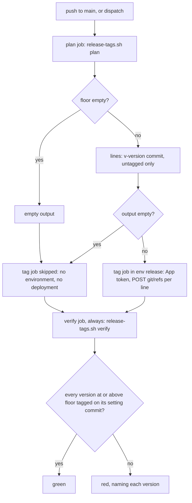

# Build-plan U1 release-tag gaps - Plan

## Goal Capsule

- **Objective:** a pin `github:kodhama/trellis#v<version>` names reviewed, merged code from the CLI's first release on, because only `main` can create a `v*` tag and CI goes red when a release has no tag or a tag on the wrong commit.
- **Means:** a tested shell script plans and verifies the tags, a workflow on `main` runs it, and a GitHub App, whose key only `main` can use, is the tag ruleset's only bypass (KTD1–KTD3).
- **Authority:** the build plan's U1 section, its KTD14 and R20, and point 11 of `docs/decisions/2026-10-20-trellis-delivers-rules-as-committed-files.md`. This file fills only the gaps they leave and overrides none of them.
- **Stop conditions:** stop and ask the lead if a test shows a decision below cannot hold, or if the maintainer's settings cannot match KTD3.
- **Execution profile:** one PR, test-first, four commits in the order of the units below. "Build-plan U1" means the source unit; U1–U4 below are this file's units.

---

## Product Contract

### Summary

The build plan's U1 says what the tag workflow must do. It does not say where its logic lives, how that logic is tested, which bypass actor the ruleset uses, or how the maintainer's settings are written down. This file decides those points and lists the failing tests to write first.

### Problem Frame

Build-plan U1's execution note leaves the workflow's logic to a fork run or `act`, so none of its seven test scenarios would run in CI. Its step 3 makes the bypass actor depend on a live probe that was not run.

### Requirements

R20 of the build plan governs, unchanged. This file adds no requirement.

---

## Planning Contract

### Key Technical Decisions

The story lead settled KTD1–KTD6. Each was checked against the repo at `02ccc5b`. KTD7–KTD9 are gaps this file adds.

- KTD1. **The tag logic is `scripts/release-tags.sh`, with modes `plan` and `verify`.**
  - `plan` prints one `v<version> <commit>` line for each version at or above the floor that has no tag.
  - `verify` exits non-zero and names every version at or above the floor whose tag is missing or points at a commit other than the one that set it.
  - Versions come from `package.json`'s top-level `version` at each commit of `git rev-list --first-parent --reverse HEAD -- package.json`. The commit that set a version is the first one at which the field took that value. A commit with no `version` field is skipped.
  - The floor comes from an environment variable that `release-tag.yml` sets. It is committed empty, and an empty floor makes both modes print nothing and exit 0. A floor that is not a SemVer string exits 2.
  - "At or above" uses `sort -V`, as `release-guard.yml:104` already does.
  - The script reads only the top-level field. A commit where `package.json` is absent counts as having no version. CRLF line endings are accepted.
  - Gap added: a version at or above the floor that carries a prerelease or build suffix (`-` or `+`) exits 2 in both modes. `sort -V` puts `0.25.0-rc.1` after `0.25.0`, and the parity test's `semverPattern` (`cli/plugin_package_test.go:28`) accepts such suffixes. R20 does not say how a prerelease is tagged, so the script refuses to guess.
  - Gap added: in a shallow clone the script exits 2, because a shallow history would make both modes see too little and pass.
  - *Checked:* `scripts/` exists, and `npm run lint:shell` already shellchecks `scripts/*.sh` in CI. **Flag:** `sort -V` is not POSIX. GNU `sort` on `ubuntu-latest` has it, and so does macOS `sort` (run locally), so the script is POSIX syntax plus one extension that the repo already uses.
  - *Checked:* KTD14 says the tagged commit is "the last commit to change `package.json`'s `version`". That is the same commit as KTD1's first appearance unless a version repeats. `release-guard` refuses a non-newer VERSION only on a PR that changes the payload, so a repeat is possible.
  - Gap added: a version at or above the floor that comes back after a different version makes both modes exit non-zero, naming the version and both commits that set it. Without this, the second release would stay untagged while `verify` passed against the old tag. The way out is a fresh version and a floor raised past the repeated one, so no tag moves.
- KTD2. **`.github/workflows/release-tag.yml` has three jobs: `plan`, `tag` and `verify`.** It runs on push to `main`, in one concurrency group with `cancel-in-progress: false`.
  - `plan` runs with `contents: read` and runs `plan`.
  - `tag` needs `plan` and runs only when `plan`'s output is non-empty. It uses `environment: release`. It mints an installation token with `actions/create-github-app-token` from `vars.RELEASE_APP_CLIENT_ID` (v3 of the action deprecates `app-id` for `client-id`) and `secrets.RELEASE_APP_PRIVATE_KEY`. It creates each tag with `POST /repos/{owner}/{repo}/git/refs`, which only creates and never moves a tag.
  - `verify` needs `[plan, tag]`, runs under `if: always()`, and runs `verify`.
  - While the floor is empty, `tag` never runs, so no run references `release` or records a deployment.
  - *Checked:* `cli-ci.yml` checks out with the default depth of 1 (`actions/checkout@v7`, no `fetch-depth`). `plan` and `verify` each need `fetch-depth: 0`, so that they see every commit and every tag. `verify` checks out fresh after `tag`, which is how it sees the new tags.
  - *Checked:* GitHub keeps one pending run per concurrency group and replaces any older pending run. That is safe here, because each run plans every version since the floor.
  - Gap added: the workflow also takes `workflow_dispatch`, so a failed tag can be retried when nothing else lands on `main`. A dispatch from another branch cannot tag, because `release` deploys only from `main`. The concurrency group includes `github.ref`, so such a dispatch cannot replace a pending run on `main`.
  - Gap added: when the `POST` returns 422 because the tag already exists, `tag` reads the ref. It succeeds if the tag names the planned commit and fails naming both commits if not. Any other response that is not 201 fails. A re-run of an old run can hit the 422 case.
- KTD3. **The ruleset's only bypass is a GitHub App, not GitHub Actions.**
  - *Fact:* GitHub's ruleset docs list repository admins and owners, the maintain and write roles, teams (excluding secret teams), GitHub Apps and Dependabot as bypass actors. GitHub Actions is not in that list (fetched 2026-10-20, "Creating rulesets for a repository").
  - *Inference:* a bypass is keyed on the actor, not on the ref. So if GitHub Actions could be listed, any workflow on an unmerged branch of this repo could ask for `contents: write` and create a `v*` tag.
  - The App's key lives only in environment `release`, which only `main` may deploy to.
  - *Not run:* the live API probe, which needs a scratch repo. That is the maintainer's call. Point 11 already names the App as the fallback when Actions "cannot be the ruleset's bypass actor", so this takes a branch point 11 allows.
  - The maintainer applies the settings, which KTD7 writes down.
- KTD4. **`package.json` gains `"version": "0.24.8"`, and `TestPluginPackageParity` gains the check.** `release-guard.yml` is untouched, because U9 widens it.
  - *Checked:* `package.json` has no `version` field at `02ccc5b`. `plugins/trellis/VERSION` is `0.24.8`. `TestPluginPackageParity` is at `cli/plugin_package_test.go:218`. `release-guard` keys only on `plugins/trellis/`, so this PR is not a release and needs no VERSION bump.
- KTD5. **`AGENTS.md`'s release rule ("A payload change is a release", `AGENTS.md:142`) gains one sentence on the tag.** *Checked:* every live line citation into `AGENTS.md` points at line 60 or earlier, so a sentence added after line 142 moves none of them.
- KTD6. **The dated note on `decision-0061` follows the build plan's Record schedule row, and the citation sweep runs on `02ccc5b`.** Its targets are in U4.
- KTD7. **The maintainer's settings are written in `release-tag.yml`'s header comment, and the PR body repeats them as a checklist.** The header is a file on `main` kept current, as `release-guard.yml`'s header is. A PR body is not.
  - **Flag: rebase merging must be switched off.** `gh api repos/kodhama/trellis` returns `allow_rebase_merge: true` beside `allow_squash_merge: true`. Under a rebase merge, the commit that first carries a new version is the PR's bump commit, which can come before the rest of the release and which CI never tested. R20 puts the tag "on its merge commit", and that holds only when each PR lands as one squash commit. The checklist therefore includes "squash merging only".
  - *Not adopted, by the story worker:* an escape for a tag on the wrong commit, in which the maintainer disables the ruleset, deletes the tag and enables the ruleset again. Point 11 says tags are never moved, so the header documents none; `verify` names the burned version and the maintainer decides.
- KTD8. **`package-lock.json` gains the same `version`, at its root and under `packages[""]`.** npm writes the root `version` into the lock, so without this the next `npm install` adds an unrelated diff. *Unverified:* whether `npm ci` would fail on the mismatch. U1 proves the lock is in sync by running `npm install --package-lock-only` and getting no diff.
- KTD9. **The new record's point 11 gets a dated note too.** Its sentence "A tag ruleset on `refs/tags/v*` lets only GitHub Actions create, move or delete them" stops being true under KTD3. Its first open question ("U1 (TRL-119) checks both") is answered from the docs and the reasoning in KTD3, without a probe. AGENTS.md requires the PR that makes a record's sentence untrue to add the note. This goes beyond the six settled decisions. See Open Questions.

### High-Level Technical Design

One push to `main`, through KTD2's three jobs:

### Risks

- **The `release` environment is missing when U9 sets the floor.** GitHub creates an environment that a job names but that does not exist, and it creates it with no branch policy and no secret. The token step then fails, no tag is made, and `verify` goes red. That failure is safe but confusing, so the Verification Contract's last row has the maintainer confirm the settings before U9 sets the floor.
- **The key is stored as a repository secret by mistake.** Any branch's workflow could then mint the App token and tag. KTD7's header names the environment secret as the only allowed home.

### Assumptions

- This PR's merge works without the App, the environment and the ruleset, because `tag` never runs while the floor is empty. Build-plan U1 is done only when the App exists and is installed and the ruleset is active with the App as its only bypass, since a ruleset cannot name an App that does not exist. The environment and its secret may wait until before U9 sets the floor.
- A skipped job that names an environment records no deployment. The check after merge (Verification Contract) confirms this.

---

## Implementation Units

### U1. One version line

- **Goal:** `package.json`, `package-lock.json` and `VERSION` hold one number, and a test fails when they differ.
- **Requirements:** R20; KTD4, KTD8.
- **Files:** `package.json`, `package-lock.json`, `cli/plugin_package_test.go`.
- **Test scenarios:**
  - `package.json` at `0.24.9` with VERSION at `0.24.8` fails `TestPluginPackageParity`, and the message names both values. Prove it with a local mutation run, then revert.
  - A `package.json` without a `version` field fails the same test.
- **Verification:** the parity test is green, the mutation is red, and `npm install --package-lock-only` leaves no diff.

### U2. The tag script and its tests

- **Goal:** `plan` and `verify` behave as KTD1 says, proven against temporary git repos.
- **Requirements:** R20; KTD1.
- **Dependencies:** U1, whose `version` field gives the script real input on `main`.
- **Files:** `scripts/release-tags.sh` (new), `cli/release_tags_test.go` (new).
- **Execution note:** write every scenario first and watch each fail against a missing script.
- **Patterns to follow:** `cli/plugin_hook_test.go` runs a shell file from Go through `filepath.Abs("../…")`, and `initGitRepo` is in `cli/install_script_test.go:144`. Each temporary repo isolates git config with `GIT_CONFIG_GLOBAL=/dev/null`, `GIT_CONFIG_NOSYSTEM=1`, fixed author and committer identities, and commit and tag signing switched off, because the maintainer's global config must not leak in. The tests run the script directly, as the workflow does, so a lost exec bit fails them. Tags are local, and nothing uses the network.
- **Test scenarios:** the first seven map to the build plan's U1 scenarios, in order.
  - Build-plan scenario 1 is U1's parity test.
  - Floor `0.25.0`. `v0.25.0` already names the commit that set `0.25.0`. `plan` prints nothing and exits 0.
  - Floor `0.25.0`, and `0.25.0` has no tag. `verify` exits non-zero, and its output names `v0.25.0`.
  - Commit A sets `0.25.0`. Commit B changes only `README.md`, and commit C changes only `devDependencies` in `package.json`. `plan` prints `v0.25.0 <A>`, not B or C.
  - History runs `0.25.0` (A) then `0.26.0` (D). Only `v0.26.0` exists, on D. `verify` fails naming `v0.25.0` and not `v0.26.0`.
  - Floor empty or unset, with history at `0.24.8` and then `0.25.0` and no tags. `plan` prints nothing, and `verify` exits 0.
  - Floor `0.25.0`, with `0.24.8` untagged and `0.25.0` tagged correctly. `plan` prints nothing, and `verify` exits 0.
  - Tag on the wrong commit: `v0.25.0` names C instead of A. `plan` prints nothing, because it never moves a tag. `verify` fails and names `v0.25.0`, A and C.
  - An annotated `v0.25.0` on A passes `verify`, so the script compares the tag's commit, not the tag object.
  - Floor `0.9.0` with version `0.10.0`: `plan` lists it, which shows the comparison is numeric, not lexical.
  - Floor equal to the version: the version counts.
  - Early commits whose `package.json` has no `version` are skipped, and the script raises no error.
  - An old `v0.2.30` tag below the floor is ignored by both modes.
  - `0.25.0` is set on a side branch and merged with `--no-ff`. `plan` names the merge commit on the first-parent line.
  - A floor of `v0.25.0`, with the `v` prefix, exits 2. No mode, or an unknown mode, also exits 2.
  - Floor `0.25.0` with version `0.25.1-rc.1`: both modes exit 2 and name the version.
  - A clone made with `--depth 1` from a `file://` URL of the temporary repo makes both modes exit 2. Git ignores `--depth` for a plain-path local clone.
  - A `package.json` whose only other `"version"` key is nested inside another object is read as having no version.
  - A commit that deletes `package.json` is skipped.
  - History `0.25.0` (A), `0.26.0` (D), `0.25.0` (E), floor `0.25.0`: both modes exit non-zero and name `0.25.0`, A and E.
- **Verification:** `cli/release_tags_test.go` is green under `-count=1`, and `npm run lint:shell` passes on the new script.

### U3. The workflow and its shape test

- **Goal:** `release-tag.yml` runs the script as KTD2 says, and a test pins the properties that keep `tag` off every ref but `main`.
- **Requirements:** R20; KTD2, KTD3, KTD7.
- **Dependencies:** U2.
- **Files:** `.github/workflows/release-tag.yml` (new), `cli/release_tags_test.go`.
- **Patterns to follow:** `TestCliCIProvidesNode20BeforeGoTests` (`cli/codex_hook_test.go:1012`) checks a workflow file by string index. The repo has no YAML parser, and Go's standard library has none.
- **Test scenarios** (one test that reads the workflow):
  - The floor variable is present and committed empty.
  - The workflow triggers on push to `main` and on `workflow_dispatch`, and on nothing else.
  - The top-level permissions are `contents: read`.
  - `environment: release` appears exactly once, inside `tag`.
  - `tag` creates refs with a `POST` to `git/refs`, and the file contains no `PATCH`, no `DELETE` and no `force`.
  - The `plan` and `verify` checkouts set `fetch-depth: 0`.
  - `verify` declares `needs: [plan, tag]` and `if: always()`.
  - The concurrency group includes `github.ref` and sets `cancel-in-progress: false`.
- **Approach:**
  1. The header comment carries KTD7's settings:
     - **App:** installed on this repository only, with Contents: read and write, Metadata: read, and no webhook.
     - **Environment `release`:** deployment branches set to "Selected branches and tags" with one rule, branch `main`, and no tag rule. "Protected branches only" would admit every protected branch. No required reviewers, because a reviewer would stall every release. It holds `RELEASE_APP_PRIVATE_KEY` as an environment secret, never a repository secret, which any branch's workflow could read. `RELEASE_APP_ID` is a variable.
     - **Tag ruleset:** targets `refs/tags/v*`, is active, restricts creation, update and deletion, and has the App as its only bypass, set to always.
     - **Merge methods:** squash only, with rebase merging switched off (KTD7).
  2. `plan` passes its lines to `tag` as a multi-line step output, which needs the `name<<delimiter` form of `GITHUB_OUTPUT`.
  3. `tag` asks `actions/create-github-app-token` for Contents: write only.
  4. `tag` handles the `POST` response as KTD2 says, and `verify` then reports the result.
- **Verification:** the shape test is green, and the file is otherwise exercised only on `main` (Verification Contract).

### U4. Release rule, dated notes and citation sweep

- **Goal:** `AGENTS.md` states the tag, and every record the change makes partly untrue carries its note, with its live citations corrected.
- **Requirements:** KTD5, KTD6, KTD9.
- **Dependencies:** U1–U3, which the notes describe.
- **Files:** `AGENTS.md`, `docs/decisions/0061-independent-dual-host-plugin-package.md`, `docs/decisions/0066-retire-the-surface-matrix.md`, `docs/decisions/0068-install-path-delivers-rules-through-claude-rules.md`, `docs/decisions/2026-10-20-trellis-delivers-rules-as-committed-files.md` (KTD9).
- **Approach:**
  1. The 0061 note goes below the forward-pointer block, so the record's body moves down two lines. It names the six phrases that point 11 lifts and the files that now carry the behaviour.
  2. The sweep at `02ccc5b` (the attached-id search and the bare-token search from `docs/solutions/workflow-issues/a-dated-note-moves-line-citations-a-one-line-search-misses.md`) finds the build plan's list plus the lines inside those passages. 0066's citations already pointed at 0061's numbering from before its forward pointer. Open each target. The right column is a checklist, not a delta to add:

     | Citing line | Before | After | Target |
     |---|---|---|---|
     | 0066:135 | `:200-201` | `:231-232` | "A package change now requires an intentional…" |
     | 0066:151 | `:97-147` | `:128-178` | §3 |
     | 0066:152 | `:149-166` | `:180-197` | §4 |
     | 0066:153-156 | `:155`, `:156`, `:157`, `:156` | `:186`, `:187`, `:188`, `:187` | §4's three matrix bullets |
     | 0066:158 | `0061:119-121` | `:150-152` | where `surface_id` is defined |
     | 0066:164 | `:68-84`, `:86-95`, `:168-187` | `:99-115`, `:117-126`, `:199-218` | §1, §2, §5 |
     | 0066:167 | `:189-201` | `:220-232` | Consequences |
     | 0066:169-170 | `:194-195`, `:198-199` | `:225-226`, `:229-230` | the two Consequences bullets |
     | 0066:195 | `:185-187` | `:216-218` | "Superseded `decision-0059` and `spec-0008` remain historical…" |
     | 0068:433 | `:211` | `:213` | "synchronized version or bump policy" |

  3. The note on the new record goes under its title. At `02ccc5b` no live line citation points into it, so it moves none.
- **Test expectation:** none for behaviour. The corpus conformance tests must stay green.
- **Verification:** each corrected citation lands on its target text, and `TestCorpusConform` and `TestArtifactContract` pass.

---

## Verification Contract

| Gate | Command or check | Proves |
|---|---|---|
| Go tests | `cd cli && go test -count=1 ./...` | U1–U3. `-count=1`, because the script is a file Go's test cache does not track |
| Typecheck | `cd cli && go build ./... && go vet ./...` | the new test file compiles |
| Shell lint | `npm run lint:shell` | shellcheck on `scripts/release-tags.sh` |
| Corpus | `cd cli && go test -count=1 -run 'TestCorpusConform\|TestArtifactContract' .` | U4's record edits |
| Lock sync | `npm install --package-lock-only` leaves no diff | KTD8 |
| After merge | The `release-tag` run on `main` shows `plan` and `verify` green and `tag` skipped, and the repo's Deployments list has no `release` entry | KTD2's no-deployment claim, and the build plan's "this PR's merge creates no tag" |
| Maintainer | The tag ruleset shows as active under the repository's rules, with the App as its only bypass, and rebase merging is off | the build plan's U1 Verification, and KTD7 |
| Maintainer, before U9 sets the floor | `gh api repos/kodhama/trellis/environments/release` shows the one `main` branch rule, and `gh api repos/kodhama/trellis/actions/secrets` does not list `RELEASE_APP_PRIVATE_KEY` | the two settings that, under KTD3, keep the key on `main` |

## Definition of Done

- Every scenario in U1–U3 is a test that failed first and passes now.
- The four units' files are the only files changed, apart from the PR body.
- The Verification Contract's first Maintainer row holds: the App exists and is installed, the ruleset is active with the App as its only bypass, and rebase merging is off.
- The PR body carries KTD7's settings checklist and lists the records the change noted: 0061 and the new record.
- No exploratory or abandoned code is left in the diff.

---

## Open Questions

- **KTD9's note on the new record (taken by the story worker).** AGENTS.md requires the PR that makes a record's sentence untrue to add the note, and point 11's "lets only GitHub Actions" sentence is untrue under KTD3, so the note is not optional.
- **Who owns the App (deferred to the maintainer):** an App owned by the `kodhama` organization or one owned by his personal account. Either works with KTD3.
- **Proving the App before U9 (deferred to the lead).** While the floor is empty, `tag` never runs, so U9's real release is the first run of the App, the environment and the ruleset. A dispatch-only dry run that mints the token and lists the `v*` refs, without creating any, would prove them earlier. It is left out of this PR to keep the PR small.
- **Lock behaviour (deferred to U1):** whether `npm ci` tolerates a root `version` mismatch. KTD8 avoids the question either way.
